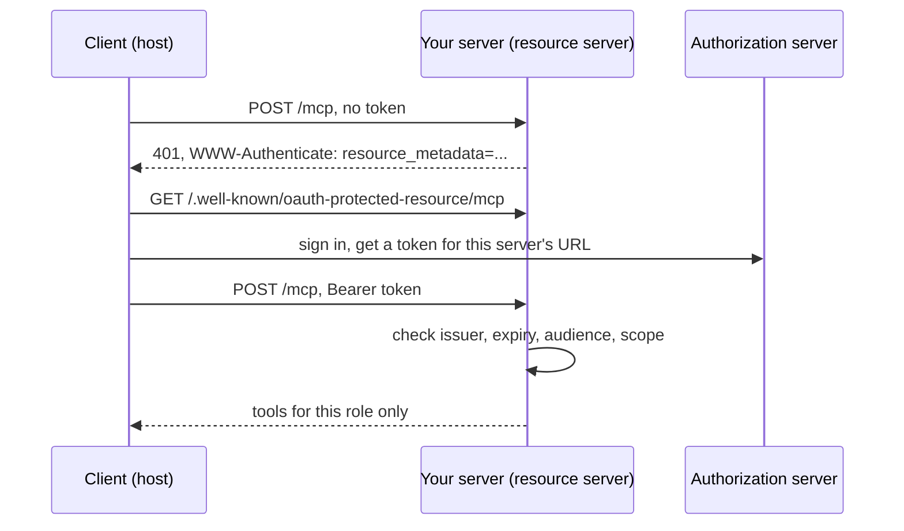

# Open the server safely

## The problem

Three sites and twelve staff cannot share a stdio server on one laptop. (A stdio server talks to one host on the
same computer.) So the server has to go remote, with a URL.

Once it has a URL, anyone who finds it can try it. One missing check can leak owners' phone numbers or a dog's
clinical notes to the wrong desk.

For example, Ola is a receptionist at Millbrook. With her token, the finished server lists six tools and no notes
tool. Dr Sam Reyes, a vet, gets a seventh tool, `read_notes`. Run `bun run try --as sam` and you see it. Your server
must make the same choice from the token alone.

In this part you make the server safe to open:

- serve the current spec over Streamable HTTP, the way MCP works over the web;
- pass the official conformance suite, a set of tests that every MCP server should pass;
- require a token, and check its audience (the server the token was made for);
- limit what each role can do;
- make cancelling an appointment wait for a person to say yes.

## Why it matters

Remote MCP adds an OAuth flow. OAuth is the standard way a user signs in and the client gets a token. Every field in
that flow comes from someone else, so you cannot trust it.

Here is a real case. The `mcp-remote` package let a bad server run commands on the user's machine. It did this with a
crafted `authorization_endpoint` URL. This is CVE-2025-6514, rated critical with a CVSS score of 9.6. It affects
versions 0.0.5 up to 0.1.16
([GitHub advisory GHSA-6xpm-ggf7-wc3p](https://github.com/advisories/GHSA-6xpm-ggf7-wc3p)).

The spec's own security guide forbids token passthrough. Passthrough means a server accepts a token made for another
server and sends it on. A server must refuse tokens that were not made for it
([Security Best Practices](https://github.com/modelcontextprotocol/modelcontextprotocol/blob/main/docs/docs/2026-07-28/tutorials/security/security_best_practices.mdx)).

The diagram shows the sign-in flow. With no token, your server answers 401 and says where to read its metadata. The
client gets a token for this server's URL and tries again. Your server checks the token, then lists only the tools
for that role.



## Steps

| Step                    | Minutes | You produce                                                                                           | The check reads                                                                                                                          |
| ----------------------- | ------- | ----------------------------------------------------------------------------------------------------- | ---------------------------------------------------------------------------------------------------------------------------------------- |
| `serve-over-http`       | 15      | `createMcpHandler` served by Bun on `127.0.0.1:8787/mcp`, with a Host check                           | a stateless `tools/list` with no session, 403 for `Host: evil.example`, a legacy-era client still served                                 |
| `pass-conformance`      | 10      | nothing new unless it fails                                                                           | `@modelcontextprotocol/conformance` exit code against the server, with a shipped expected-failures file (pin the exact version at build) |
| `require-a-token`       | 15      | `requireBearerAuth` and protected resource metadata                                                   | 401 with `WWW-Authenticate` naming the metadata URL; the metadata JSON; a token in the query string refused                              |
| `check-the-audience`    | 10      | token checks for issuer, expiry and audience; no passthrough to the PIMS                              | tokens minted for another server and expired tokens get 401; the world log shows no inbound token sent on                                |
| `limit-by-role`         | 10      | scopes `diary:read`, `diary:write`, `notes:read`, `drugs:read`, with tools hidden or refused by scope | Ola's token lists no notes tool and gets 403 on a direct call; Dr Reyes reads notes for her site only; only Joon reads the drugs log     |
| `confirm-before-cancel` | 10      | `cancel_appointment` that returns `input_required` and cancels only on a yes                          | the diary row after a first call, a retry with no, a retry with yes, and a tampered `requestState`                                       |

Total: 70 minutes. The finished server in `world/finished/` already does all six. Tokens come from `world/auth.ts`.

## Walkthrough

TODO(part session): one `bun run verify <step-name>` per step, each with its `Expect:` line.

```bash
bun run verify part open-the-server-safely
```

Expect: `Part open-the-server-safely is done: 6/6 steps pass.` once the part session has built the steps.

A later build session adds the steps of this part. Until then, the table above shows what each step asks of you.
