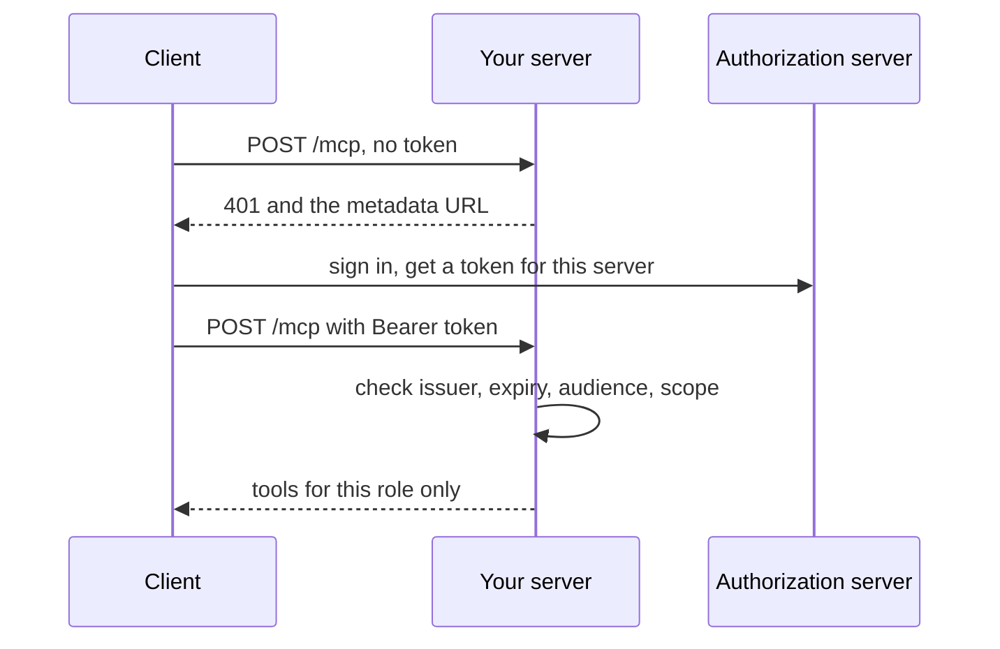

# Open the server safely

## After this part you can

Put an MCP server on a web address so that only the right people reach the right tools.

## You leave with

A remote server that passes the official conformance suite, checks every token, hides tools by role, and asks before it cancels.

## The problem

Three sites and twelve staff cannot share a stdio server on one laptop, so the server needs a URL. Once it has one, anyone who finds it can try it. For example, the `mcp-remote` package let a bad server run commands on a user's machine through a crafted login URL. That flaw is CVE-2025-6514, rated critical at 9.6 ([advisory](https://github.com/advisories/GHSA-6xpm-ggf7-wc3p)). OAuth is the standard way a user signs in and the client gets a token. Every field in that flow comes from someone else, so you cannot trust it.



## Steps

| Step                    | You produce                                                                 | The check reads                                                                |
| ----------------------- | --------------------------------------------------------------------------- | ------------------------------------------------------------------------------ |
| `serve-over-http`       | `createMcpHandler` served by Bun on port 8787, with a Host check            | a stateless `tools/list`, 403 for a strange Host, an older client still served |
| `pass-conformance`      | a fix to `http.ts`, so the official suite passes                            | the conformance suite and `conformance-expected-failures.yml`                  |
| `require-a-token`       | `requireBearerAuth` and protected resource metadata                         | 401 with `WWW-Authenticate`, the metadata JSON, a query-string token refused   |
| `check-the-audience`    | token checks for issuer, expiry and audience, with no passthrough           | tokens for another server and expired tokens get 401                           |
| `limit-by-role`         | scopes `diary:read`, `diary:write`, `notes:read`, `drugs:read` on the tools | Ola lists no notes tool and gets 403; Dr Reyes reads her own site's notes      |
| `confirm-before-cancel` | `cancel_appointment` that returns `input_required` and waits for a yes      | the diary after a no, a faked yes, a borrowed state, and a real yes            |

## Watch and read

| Kind  | Title                                                            | Author                                | Why                                                                      | Link                                                                                            |
| ----- | ---------------------------------------------------------------- | ------------------------------------- | ------------------------------------------------------------------------ | ----------------------------------------------------------------------------------------------- |
| video | How to Secure Agents using OAuth                                 | Jared Hanson, Keycard, at AI Engineer | Clients, resource servers and authorization servers, then applied to MCP | https://www.youtube.com/watch?v=blmAkayzE8M                                                     |
| video | Securing Agents with Open Standards                              | Auth0, at AI Engineer                 | Tying agent access to individual users with open standards               | https://www.youtube.com/watch?v=FZoMSupg37E                                                     |
| read  | MCP specification: Authorization                                 | MCP maintainers                       | The rules your 401, metadata and audience check come from                | https://modelcontextprotocol.io/specification/latest/basic/authorization                        |
| read  | Authorization Security Considerations                            | MCP maintainers                       | Audience binding, no token passthrough and confused deputy risks         | https://modelcontextprotocol.io/specification/draft/basic/authorization/security-considerations |
| read  | Protected Resource Metadata (RFC 9728)                           | IETF                                  | The standard behind the metadata file your server publishes              | https://datatracker.ietf.org/doc/html/rfc9728                                                   |
| read  | Evolving OAuth Client Registration in the Model Context Protocol | Paul Carleton, MCP maintainers blog   | Why client sign-up works the way it does in MCP                          | https://blog.modelcontextprotocol.io/posts/client_registration/                                 |

## Project

Take one server of your own. Serve it over HTTP, run the conformance suite, then require a token and refuse one made for another server. Give two roles different tool lists. You are done when a missing, forged or misdirected token gets 401, and the second role gets 403 on a tool it should not have.

## Walkthrough

Work in each step's `problem/` folder. Every step has two files you change: `server.ts` (the tools) and `http.ts` (how requests arrive). Each starter is the step before's solution, plus TODO lines. Tokens come from `world/auth.ts`, and your server imports what it needs from `clinic-login.ts` in this folder.

```bash
cd parts/03-open-the-server-safely/01-serve-over-http/problem && bun http.ts
```

Expect: `harrow-lane server listening on http://127.0.0.1:8787/mcp`. Press Ctrl+C to stop it.

From `require-a-token` on, talk to it as one of the demo staff:

```bash
bun parts/03-open-the-server-safely/call-server.ts --as sam
```

Expect: `As sam, your server lists 7 tool(s):` once you finish `limit-by-role`.

```bash
bun run verify part open-the-server-safely
```

Expect: `Part open-the-server-safely is done: 6/6 steps pass.`

## Why it matters

The spec's security guide forbids token passthrough, where a server accepts a token made for another server and sends it on. A server must refuse tokens that were not made for it.

## Finished

You now have a remote server the whole clinic can use. Ola's token lists six tools, Dr Reyes's lists seven, and only Joon reads the controlled-drugs register. A cancel waits for a person's yes that cannot be faked. The next part, defend-and-ship, puts this server in front of real risk and deploys it at a public URL.
