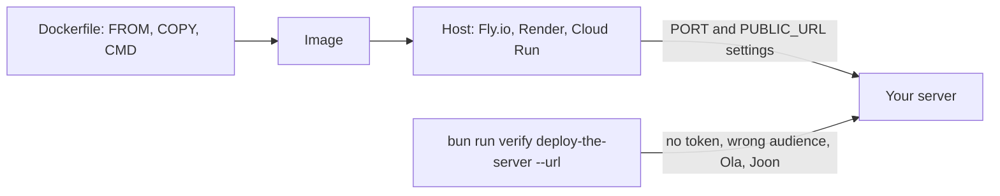

# Deploy the server

## The problem

Your server works on `http://127.0.0.1:8787/mcp`. That address only exists on your laptop. Dr Reyes at Millbrook
and Joon at Harrow Lane need one public address, such as `https://harrow-lane.fly.dev/mcp`.

A server that moves to a host often breaks in three quiet ways:

- it listens on port 8787, but the host gives it another port in the `PORT` setting;
- it still believes its address is `127.0.0.1:8787`. So it refuses the public host name, or refuses tokens minted
  for the public address;
- it listens on `127.0.0.1`, so nothing outside the container reaches it.

For example, the starter `app.ts` builds its address from `127.0.0.1:8787`. Send it a request for
`harrow-lane.example.net`, and its Host check answers 403 before any token is read.



## Your challenge

1. In `app.ts`, read `PUBLIC_URL`. Use it for the resource URL, the allowed host names and the token audience.
2. In `serve.ts`, read `PORT` and listen on `0.0.0.0`.
3. Write a `Dockerfile` in this folder. Build it from the repo root, and keep the repo's folder layout inside. End with a `CMD` in JSON form, such as
   `CMD ["bun", "parts/04-defend-and-ship/03-deploy-the-server/problem/serve.ts"]`.
4. Rehearse with the command under Done when. It starts your `CMD` the way a host would, with its own `PORT`
   and `PUBLIC_URL`.
5. Deploy the image to any host that runs a Dockerfile. Set `PUBLIC_URL` to the address it gives you. Then check
   the live server:

   ```bash
   bun run verify deploy-the-server --url https://your-server.example/mcp
   ```

   Expect: `Done. All 7 rules pass.`, with every request sent to your live address.

Your screen should look like this:


Why not Cloudflare Workers? The clinic's PIMS uses `bun:sqlite`, and Workers cannot run it.

## Done when

- The `Dockerfile` has `FROM` and a `CMD` whose script exists from the repo root.
- The server answers on the port the host gives it in `PORT`.
- A request with no token gets 401 and a `WWW-Authenticate` header with the metadata URL.
- The metadata names the public address as the resource.
- Joon's token for the public address lists the tools.
- A token minted for another server gets 401.
- Ola's token sees no `read_notes`, and a direct `read_notes` call is refused.

```bash
bun run verify deploy-the-server
```

Expect: `Done. All 7 rules pass.` once your work meets every Done when line. Before that, each FAIL line has a `Try next:`.

## If you get stuck

- 403 on every request: the Host check does not know the public host name. Add `new URL(PUBLIC_URL).hostname`.
- Joon's token gets 401: the server still expects tokens for `127.0.0.1:8787`. Use `PUBLIC_URL` as the expected
  resource.
- The live server never answers: read the host's logs. Does it listen on `0.0.0.0` and on `PORT`?
- The course's signing key lets the check mint tokens. That is safe only because the clinic data is made up.

## Words you will use

- **Image**: a packed copy of your server and everything it needs, built from a `Dockerfile`.
- **`PORT`**: the setting a host uses to tell your server which port to listen on.
- **`PUBLIC_URL`**: the address people use to reach your server. Tokens are minted for exactly this address.
- **`0.0.0.0`**: "listen on every network", so traffic from outside the container gets in.
