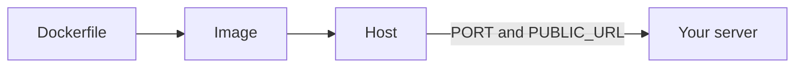
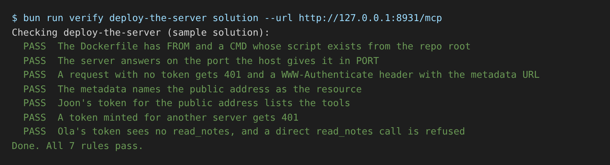

# Deploy the server

## The problem

For example, your server answers on `http://127.0.0.1:8787/mcp`, an address that exists only on your laptop. Dr Reyes at Millbrook and Joon at Harrow Lane need one public address, such as `https://harrow-lane.fly.dev/mcp`. The host picks the port and the public name, so a fixed address breaks.



## Watch it done

Before, the starter has no `Dockerfile`, a fixed port and a fixed address:

```text
Checking deploy-the-server (your work):
  FAIL  The Dockerfile has FROM and a CMD whose script exists from the repo root
  FAIL  The server answers on the port the host gives it in PORT
  FAIL  A request with no token gets 401 and a WWW-Authenticate header with the metadata URL
        Try next: a 403 means the Host check refused the rehearsal address ...
```

After, the solution passes:

```text
  PASS  The server answers on the port the host gives it in PORT
  PASS  Joon's token for the public address lists the tools
  PASS  A token minted for another server gets 401
Done. All 7 rules pass.
```



## Your turn

1. In `app.ts`, read `PUBLIC_URL`. Use it for the resource address, the allowed host names and the token audience.
2. In `serve.ts`, read `PORT` and listen on `0.0.0.0`. A container takes outside traffic only on that address.
3. Write a `Dockerfile` in this folder, built from the repo root. End with a `CMD` in JSON form that names your `serve.ts`.
4. Rehearse. The check starts your `CMD` the way a host would, with its own `PORT` and `PUBLIC_URL`.

```bash
bun run verify deploy-the-server
```

Expect: `Done. All 7 rules pass.`

## Do it on your work

Copy your own server from Part 3 into this folder, keeping `serve.ts` as the file the `Dockerfile` starts. Deploy the image to any host that runs a Dockerfile, and set `PUBLIC_URL` to the address it gives you. Then check the live server.

```bash
bun run verify deploy-the-server --url https://your-server.example/mcp
```

Expect: `Done. All 7 rules pass.` Good looks like a public address that refuses a missing token and a token minted for another server.

## Done when

- The `Dockerfile` has `FROM` and a `CMD` that names a real script.
- The server answers on the port in `PORT`.
- No token gives 401 and a `WWW-Authenticate` header with the metadata address.
- The metadata names the public address as the resource.
- Joon's token for the public address lists the tools.
- A token minted for another server gets 401.
- Ola's token sees no `read_notes`, and a direct call is refused.

## Solution

The after state is three files. See `solution/Dockerfile`, `solution/serve.ts` and `solution/app.ts`.

## Go further

Why not Cloudflare Workers? The clinic's PIMS uses `bun:sqlite`, and Workers cannot run it.

## If you get stuck

- 403 on every request: the Host check does not know the public name. Add `new URL(PUBLIC_URL).hostname`.
- Joon's token gets 401: use `PUBLIC_URL` as the expected resource.
- The live server never answers: read the host's logs. Does it listen on `0.0.0.0` and on `PORT`?

## Words you will use

- **Image**: a packed copy of your server and what it needs, built from a `Dockerfile`.
- **`PORT`**: the setting a host uses to tell your server which port to listen on.
- **`PUBLIC_URL`**: the address people use to reach your server. Tokens are minted for exactly this address.
- **`0.0.0.0`**: listen on every network, so outside traffic gets in.
