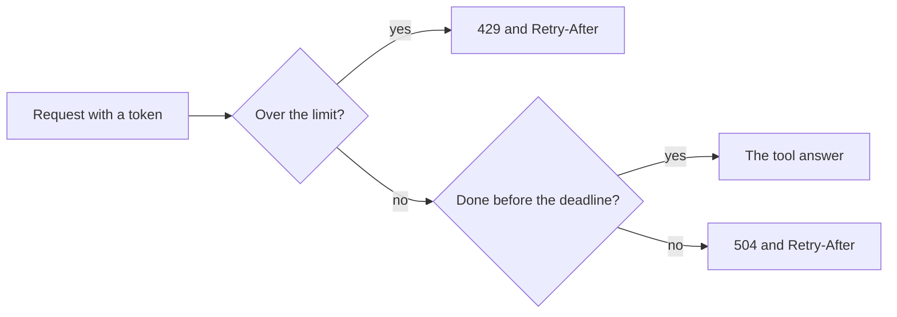

# Limit requests

## The problem

Your server is now public. One client can send a thousand requests in a minute, and one slow tool can keep a caller
waiting for ever. Either one can take the clinic's diary down for everyone.

For example, a buggy script for Joon sends 80 `tools/list` requests in a row. Ola, at the front desk, then gets
no answer at all.

A **rate limit** is a cap on how many requests one client may send in a minute. A **deadline** is the longest one
request may run.



## Your challenge

1. Open `app.ts`. It is the server from the deploy step.
2. Add a rate limit. Count requests for each client, using the token's subject (`authInfo.clientId`). Read the cap
   from `RATE_LIMIT_PER_MINUTE`, and use 60 when it is not set. Over the cap, answer 429 with a `Retry-After`
   header that says how many seconds to wait.
3. Add a deadline. Read `REQUEST_TIMEOUT_MS`, and use 15000 when it is not set. A request that runs past it gets
   504 with a `Retry-After` header.
4. Run the check. It starts `serve.ts` with its own `PORT` and `PUBLIC_URL`.

## Done when

- The server still answers a normal request.
- A client that sends too many requests gets 429 and a `Retry-After` header in seconds.
- The limit is per client, so Ola is still served after Joon is limited.
- A request that runs past the deadline gets 504 and a `Retry-After` header.

```bash
bun run verify limit-requests
```

Expect: `Done. All 4 rules pass.` once your work meets every Done when line. Before that, each FAIL line has a `Try next:`.

## If you get stuck

- Ola is limited too: you counted with one fixed key. Count with the token's subject.
- The 504 never comes: a deadline of zero must mean no time at all. Do not treat zero as "not set".
- A late answer slips through: after the race, check the time again and drop an answer that came late.

## Words you will use

- **Rate limit**: a cap on how many requests one client may send in a minute.
- **Deadline**: the longest a request may run before the server gives up and answers 504.
- **`Retry-After`**: a header that tells the client how many seconds to wait before it tries again.
