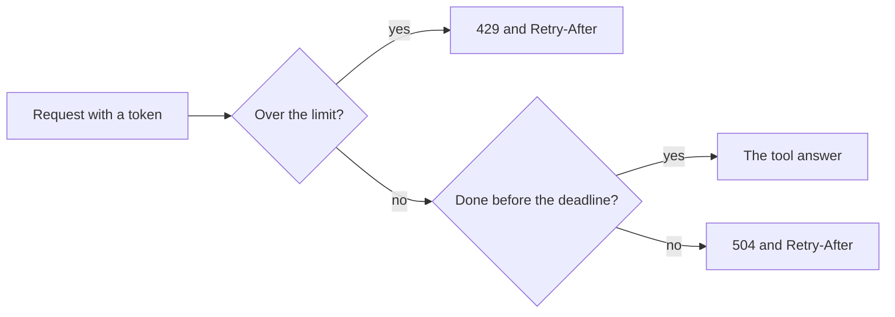

# Limit requests

## The problem

For example, your server is public. A buggy script for Joon sends 80 `tools/list` requests in a row, and Ola at the front desk then gets no answer at all. A rate limit caps how many requests one client may send in a minute. A deadline is the longest one request may run.



## Watch it done

Before, the starter has neither guard:

```text
Checking limit-requests (your work):
  PASS  The server still answers a normal request with the default deadline
  FAIL  A client that sends too many requests gets 429 and a Retry-After header in seconds
  FAIL  The limit is per client: Ola is still served after Joon is limited
  FAIL  A request that runs past the deadline gets 504 and a Retry-After header
1 of 4 rules pass. Fix the FAIL lines and run it again.
```

After, the solution passes:

```text
Done. All 4 rules pass.
```

## Your turn

1. Open `app.ts`. It is the server from the deploy step.
2. Add the rate limit. Count requests for each client, using the token's subject, `authInfo.clientId`. Read the cap from `RATE_LIMIT_PER_MINUTE`, and use 60 when it is not set.

Expect: past the cap, a 429 with a `Retry-After` header that says how many seconds to wait.

3. Add the deadline. Read `REQUEST_TIMEOUT_MS`, and use 15000 when it is not set.

Expect: a request that runs past it gets 504 with a `Retry-After` header.

4. Run the check. It starts `serve.ts` with its own `PORT` and `PUBLIC_URL`.

```bash
bun run verify limit-requests
```

Expect: `Done. All 4 rules pass.`

## Do it on your work

Pick the busiest tool on your own server. Choose a cap that a person at a desk would never reach, and a deadline a little above the slowest honest call. Good looks like one client at the cap getting 429 while another is still served.

## Done when

- The server still answers a normal request.
- A client that sends too many requests gets 429 and a `Retry-After` header in seconds.
- The limit is per client, so Ola is served after Joon is limited.
- A request past the deadline gets 504 and a `Retry-After` header.

## Solution

The after state is a counter for each client and a race against a timer. See `solution/app.ts` and `solution/serve.ts`.

## Go further

A counter in memory resets when the server restarts, and it is not shared by two copies of the server. Say what you would use for a shared count.

## If you get stuck

- Ola is limited too: you counted with one fixed key. Count with the token's subject.
- The 504 never comes: a deadline of zero must mean no time at all. Do not treat zero as "not set".
- A late answer slips through: after the race, check the time again and drop an answer that came late.

## Words you will use

- **Rate limit**: a cap on how many requests one client may send in a minute.
- **Deadline**: the longest a request may run before the server gives up and answers 504.
- **`Retry-After`**: a header that tells the client how many seconds to wait before it tries again.
