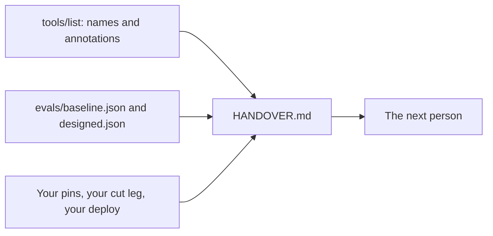

# Write the handover

## The problem

The server is live. Next month someone else looks after it. Maybe it is a new engineer, or you after a long break.
They need to know four things fast: what the server can do, who may do what, how good its tool choice is, and what
attacks it stops.

Handover notes often go wrong in one way: the numbers are typed from memory. A score that says 12/20 when the eval
file says 9/20 makes every other line hard to trust.

For example, `evals/baseline.json` in this folder ends its header with `"passed": 9, "total": 20`. So your handover
says 9/20 for the server built from the PIMS API, not "about half".



## Your challenge

1. If you have your own `evals/baseline.json` and `evals/designed.json` from `shape-tools-around-jobs`, copy
   them into `evals/` here. If not, use the sample files that are already here.
2. List the tools the finished server shows the director:

   ```bash
   bun run try --as joon
   ```

   Expect: `The finished server, as joon, has 8 tool(s):`, then one line per tool.

3. Fill in every section of `HANDOVER.md`. Replace each TODO.
   - **Tools**: one line per tool. Mark it "Read-only", "Writes, not destructive" or "Destructive". The
     annotations are in `world/finished/server.ts`.
   - **Scopes**: the four scopes, what each allows, and who gets it.
   - **Eval scores**: before and after, written like `9/20`, copied from the JSON.
   - **Threats and defences**: tool poisoning, prompt injection, and a token minted for another server. Name the
     defence you built for each.
   - **How to deploy** and **Not done yet**: short and honest.

If you already know this: the check reads the score from `passed` (or `score`) and `total`, or counts the `tasks`
that have `"pass": true`.

## Done when

- `HANDOVER.md` has the six sections, and no TODO is left.
- The Tools section names every tool from `tools/list`.
- Each tool is marked read-only, writes or destructive, as its annotations say.
- The Scopes section names all four scopes.
- The eval scores match `evals/baseline.json` and `evals/designed.json`.
- Threats and defences covers tool poisoning, prompt injection and a token for another server.

```bash
bun run verify write-the-handover
```

Expect: `Done. All 6 rules pass.` once your work meets every Done when line. Before that, each FAIL line has a `Try next:`.

## If you get stuck

- The scores rule fails: open the JSON files and copy `passed` and `total`. Write them as `9/20`.
- A tool is missing: `cancel_appointment` is the one people forget. It is also the only destructive one.
- Not sure what to write under a threat? Say what the attack does in one sentence, then which step stops it.

## Words you will use

- **Handover**: a short document that lets the next person run and change the server without asking you.
- **Annotation**: a hint on a tool, such as `readOnlyHint` or `destructiveHint`. A host uses it to decide when to
  ask the person first.
- **Baseline**: the score before a change, so you can show what the change did.
