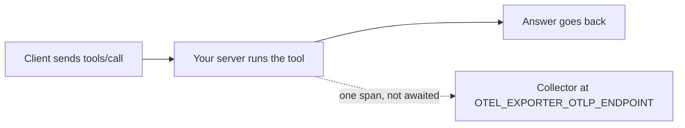

# Trace every tool call

## The problem

At 09:12 a vet says "the diary tool was slow". Your logs show nothing. You cannot tell which tool, which call, or
how long it took.

A **trace** is a record of one piece of work, made of **spans**. A span is one step, with a start time, an end
time and a few labels. OpenTelemetry (OTel) is the open standard for them. Any tool that speaks it can show your
spans on a chart.

For example, `find_free_slots` takes 40 ms for Joon, and `read_notes` fails for Ola. Each call should leave one span,
and the failed one should be marked.



## Your challenge

1. Open `app.ts`. It is the server from the deploy step.
2. For each `tools/call` request, time the call and build one span. Name it `tools/call` and a space and the tool
   name, such as `tools/call find_patient`.
3. Give the span three labels: `mcp.method.name` is `tools/call`, `gen_ai.operation.name` is `execute_tool`, and
   `gen_ai.tool.name` is the tool name.
4. Use a random 32 digit trace id and 16 digit span id, in lower case hex. If the request has a `traceparent`
   header, reuse its trace id, and use its parent id as `parentSpanId`.
5. When the call fails, set the status code to 2 and add an `error.type` label.
6. Post the span as OTLP JSON to `OTEL_EXPORTER_OTLP_ENDPOINT` plus `/v1/traces`. Do not wait for the answer, and
   ignore errors.
7. Keep private data out. Record names and outcomes, never the arguments.

## Done when

- Each tool call leaves one span named after the method and the tool.
- Each span names the method, the operation and the tool.
- Each span has a 32 digit trace id, a 16 digit span id and an end after its start.
- A request with a `traceparent` header joins that trace.
- A failed call is marked as an error, and a good call is not.
- No span holds a pet name, a patient id or any tool argument.
- A collector that is down does not slow or break a tool call.

```bash
bun run verify trace-every-tool-call
```

Expect: `Done. All 7 rules pass.` once your work meets every Done when line. Before that, each FAIL line has a `Try next:`.

## If you get stuck

- No span arrives: the check sets `OTEL_EXPORTER_OTLP_ENDPOINT`. Post to that address plus `/v1/traces`.
- The times are rejected: send them as strings of nanoseconds, not numbers.
- A tool call is slow when the collector is down: you waited for the post. Let it run on its own.

## Words you will use

- **Span**: one step of work, with a start, an end and labels.
- **Trace**: all the spans for one request, joined by one trace id.
- **Collector**: a service that receives spans and stores them.
- **`traceparent`**: a header that carries a trace id from one service to the next.
