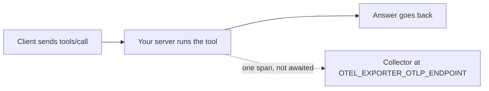

# Trace every tool call

## The problem

A vet says the diary tool was slow this morning. Your logs show nothing, so you cannot tell which tool, which call, or how long. A span is one step of work with a start, an end and labels. A trace joins the spans of one request. OpenTelemetry is the open standard for both.



## Watch it done

Before, the starter sends no span:

```text
Checking trace-every-tool-call (your work):
  FAIL  Each tool call leaves one span named after the method and the tool
  FAIL  Each span names the method, the operation and the tool
  FAIL  A request with a traceparent header joins that trace
  PASS  A collector that is down does not slow or break a tool call
1 of 7 rules pass. Fix the FAIL lines and run it again.
```

After, the solution passes:

```text
Done. All 7 rules pass.
```

## Your turn

1. Open `app.ts`. It is the server from the deploy step.
2. For each `tools/call`, time the call and build one span named `tools/call` and a space and the tool name, such as `tools/call find_patient`.
3. Add three labels: `mcp.method.name` is `tools/call`, `gen_ai.operation.name` is `execute_tool`, and `gen_ai.tool.name` is the tool name.

Expect: the check finds one span for each call, with those labels.

4. Use a random 32 digit trace id and 16 digit span id, in lower case hex. If the request has a `traceparent` header, reuse its trace id, and use its parent id as `parentSpanId`.
5. When a call fails, set the status code to 2 and add an `error.type` label.
6. Post the span as OTLP JSON to `OTEL_EXPORTER_OTLP_ENDPOINT` plus `/v1/traces`. Do not wait for the answer, and ignore errors. Record names and outcomes, never arguments.
7. Run the check.

```bash
bun run verify trace-every-tool-call
```

Expect: `Done. All 7 rules pass.`

## Do it on your work

Send spans from your own server to any collector you already run, or a local one. Open one slow call and read its name and length. Good looks like finding the tool and the time without reading any private data.

## Done when

- Each tool call leaves one span named after the method and the tool.
- Each span names the method, the operation and the tool.
- Each span has a 32 digit trace id, a 16 digit span id and an end after its start.
- A request with a `traceparent` header joins that trace.
- A failed call is marked as an error, and a good call is not.
- No span holds a pet name, a patient id or any tool argument.
- A collector that is down does not slow or break a call.

## Solution

The after state is span code inside the HTTP front. See `solution/app.ts` and `solution/serve.ts`.

## Go further

Add a span for the PIMS call inside each tool, as a child of the tool span. Then you can tell a slow tool from a slow back end.

## If you get stuck

- No span arrives: the check sets `OTEL_EXPORTER_OTLP_ENDPOINT`. Post to that address plus `/v1/traces`.
- The times are rejected: send them as strings of nanoseconds, not numbers.
- A call is slow when the collector is down: you waited for the post. Let it run on its own.

## Words you will use

- **Span**: one step of work, with a start, an end and labels.
- **Trace**: all the spans for one request, joined by one trace id.
- **Collector**: a service that receives spans and stores them.
- **`traceparent`**: a header that carries a trace id from one service to the next.
