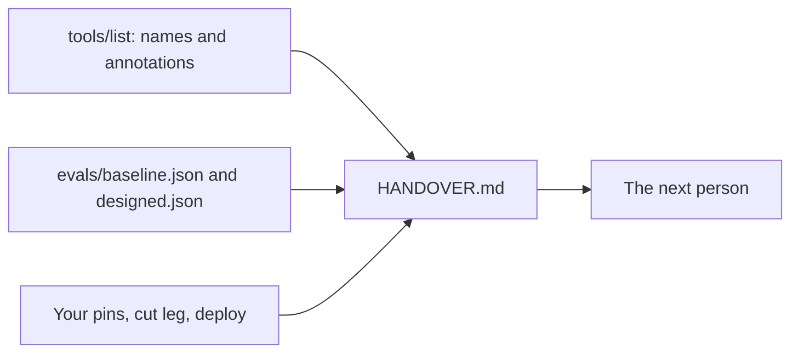

# Write the handover

## The problem

Next month someone else looks after the live server, or you do after a long break. Handover notes often go wrong in one way: the numbers are typed from memory. A score that says 12/20 when `evals/baseline.json` says 9/20 makes every other line hard to trust.



## Watch it done

Before, the starter `HANDOVER.md` is all TODO:

```text
Checking write-the-handover (your work):
  FAIL  HANDOVER.md has the six sections, and no TODO is left
  FAIL  The Tools section names every tool from tools/list
  FAIL  The eval scores match evals/baseline.json and evals/designed.json
0 of 6 rules pass. Fix the FAIL lines and run it again.
```

After, the solution writes `9/20` and `19/20`, copied from the two files:

```text
Done. All 6 rules pass.
```

## Your turn

1. If you have your own `evals/baseline.json` and `evals/designed.json` from `shape-tools-around-jobs`, copy them into `evals/` here. If not, use the samples already there.
2. List the tools the finished server shows the director.

```bash
bun run try --as joon
```

Expect: a line with the tool count, then one line per tool.

3. Fill in the Tools section: one line per tool, marked "Read-only", "Writes, not destructive" or "Destructive". The annotations are in `world/finished/server.ts`.
4. Fill in Eval scores, written like `9/20`, copied from the JSON.
5. Fill in the other sections, and replace every TODO. Run the check.

```bash
bun run verify write-the-handover
```

Expect: `Done. All 6 rules pass.`

## Do it on your work

Write a one page handover for your own server. Take every number from a file, never from memory. Good looks like a reader who can find a tool, a scope or a score, and can see which attack each defence stops.

## Done when

- `HANDOVER.md` has the six sections, and no TODO is left.
- The Tools section names every tool from `tools/list`, each marked as its annotations say.
- The Scopes section names all four scopes.
- The eval scores match the two JSON files.
- Threats and defences covers tool poisoning, prompt injection and a token for another server.

## Solution

The after state is one finished `HANDOVER.md` beside its two eval files. See `solution/HANDOVER.md` and `solution/evals/`.

## Go further

Add a runbook line for each threat: what you see when it happens, who to call, and the first thing to try. The check reads `passed` and `total`, or counts the `tasks` that have `"pass": true`.

## If you get stuck

- The scores rule fails: copy `passed` and `total` from the JSON. Write them as `9/20`.
- A tool is missing: `cancel_appointment` is the one people forget. It is also the only destructive one.
- Not sure what to write under a threat? Say what the attack does in one sentence, then which step stops it.

## Words you will use

- **Handover**: a short document that lets the next person run and change the server without asking you.
- **Annotation**: a hint on a tool, such as `readOnlyHint` or `destructiveHint`. A host uses it to decide when to ask the person first.
- **Baseline**: the score before a change, so you can show what the change did.
