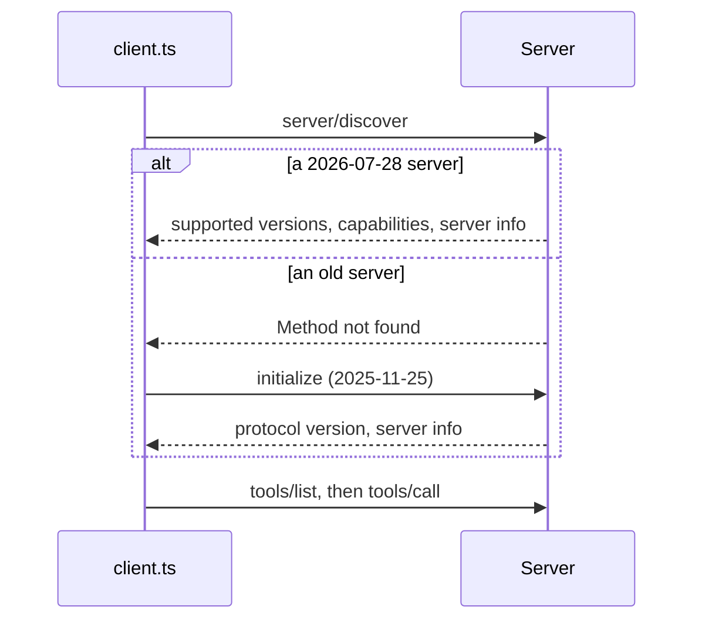

# Build a small client

## The problem

A second team at Harrow Lane builds a dashboard for the lab. It must call MCP servers from code, without a chat
host in between. So they need a client: the program on the other end of the protocol.

The servers do not all speak the same version. Your Harrow Lane server speaks the 2026-07-28 protocol. It answers
`server/discover`, so a client learns everything in one request. The lab's old server speaks only 2025-11-25. It
needs `initialize` first, and it does not know `server/discover`.

For example, here is what a good client prints for each server:

```text
Server: harrow-lane 0.1.0                      Server: harrow-lab-legacy 1.2.0
Protocol: 2026-07-28 (modern)                  Protocol: 2025-11-25 (legacy)
Supported versions: 2026-07-28                 Supported versions: unknown, the server has no server/discover
```



## Your challenge

Open `client.ts`. It connects, prints the server and protocol, and lists tools. Finish the three TODOs:

1. Turn on version negotiation: `{ versionNegotiation: { mode: "auto" } }`. With "auto", the client asks
   `server/discover` first, and falls back to `initialize` when the server does not know it.
2. Print `Supported versions:` from `client.getDiscoverResult()`.
3. Call the tool named on the command line, with `callOneTool`.

Try it on the lab's old server:

```bash
cd parts/05-grow-the-server/01-build-a-small-client/problem && bun client.ts ../legacy-lab/server.ts lab_status '{}'
```

Expect: `Protocol: 2025-11-25 (legacy)`, then `Called lab_status:` and `The lab is open.` once you are done.

Your screen should look like this:


If you already know this: `mode: { pin: "2026-07-28" }` refuses any server that cannot offer that version. Use a pin
only when you control every server.

## Done when

- With the Part 1 server, it speaks 2026-07-28 (the Protocol line).
- It prints the versions that `server/discover` lists (the Supported versions line).
- It lists the tools: `find_free_slots` and `book_appointment` (the Tools line).
- It calls `find_free_slots` and prints real free slots from the diary.
- With the lab's old server, it falls back to 2025-11-25 and still calls `lab_status`.

```bash
bun run verify build-a-small-client
```

Expect: `Done. All 5 rules pass.` once your work meets every Done when line. Before that, each FAIL line has a `Try next:`.

## If you get stuck

- The Part 1 server shows 2025-11-25: you left out `versionNegotiation`. Without it, the client stays on the old
  protocol, even with a new server.
- The old server fails to connect: you pinned 2026-07-28. Use `"auto"`.
- The check runs `bun client.ts <server.ts> <tool> '<json>'` in your folder, so keep that command shape.

## Words you will use

- **Client**: the program that sends MCP requests. A host such as Claude Code has one inside.
- **`server/discover`**: the 2026-07-28 request that returns a server's versions, capabilities and name at once.
- **Version negotiation**: how a client and a server agree on one protocol version before they work.
