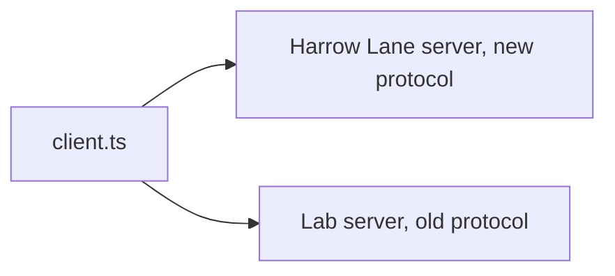
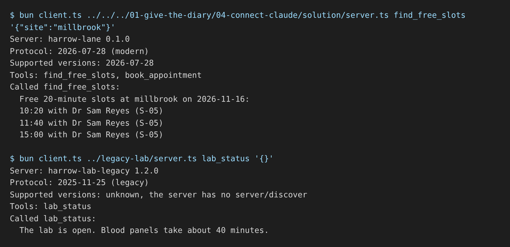

# Build a small client

## The problem

A dashboard team must call MCP servers from code, with no chat host between. That needs a client, the program on the other end of the protocol. For example, the Harrow Lane server and the lab's old server speak two protocol versions. One client must work with both.



## Watch it done

Before, the starter client reaches the old lab server but stops at a TODO:

```text
Server: harrow-lab-legacy 1.2.0
Protocol: 2025-11-25 (legacy)
Tools: lab_status
TODO: call lab_status on harrow-lab-legacy with {}
```

After, the finished client prints this for the old server:

```text
Server: harrow-lab-legacy 1.2.0
Protocol: 2025-11-25 (legacy)
Supported versions: unknown, the server has no server/discover
Tools: lab_status
Called lab_status:
  The lab is open. Blood panels take about 40 minutes.
```

For the Harrow Lane server, the same client prints `Protocol: 2026-07-28 (modern)` and a list of one supported version. The check goes from one rule passing to `Done. All 5 rules pass.`



## Your turn

1. Open `client.ts` in this step's `problem/` folder. Run it on the old lab server.

```bash
cd parts/05-grow-the-server/01-build-a-small-client/problem && bun client.ts ../legacy-lab/server.ts lab_status '{}'
```

Expect: `Protocol: 2025-11-25 (legacy)` and a line that starts with `TODO: call`.

2. Turn on version negotiation. Pass this as the second argument of `new Client(info, options)`:

```ts
{
  versionNegotiation: {
    mode: "auto";
  }
}
```
With auto, the client asks `server/discover` first. If the server does not know it, the client falls back to `initialize`.
3. Print `Supported versions:` from `client.getDiscoverResult()?.supportedVersions`. An old server gives no list.
4. In `callOneTool`, call `client.callTool` and print `Called <tool>:` with the first lines of its text.
5. Run it on the old server again.

Expect: `Called lab_status:` and `The lab is open.`

6. Run it on the Part 1 server.

```bash
bun client.ts ../../../01-give-the-diary/01-expose-the-diary/solution/server.ts find_free_slots '{"site":"millbrook"}'
```

Expect: `Protocol: 2026-07-28 (modern)` and real free slots.

## Do it on your work

Point the same client at a server you built, one that starts with `bun your-server.ts`. Call one read-only tool. Good looks like a protocol line, a tool list and a real answer. If it fails, read the error first: the server may need an environment variable.

## Done when

- With the Part 1 server, it speaks `2026-07-28`.
- It prints the versions that `server/discover` lists.
- It lists `find_free_slots` and `book_appointment`.
- It calls `find_free_slots` and prints real slots.
- With the old lab server, it falls back to `2025-11-25` and still calls `lab_status`.

```bash
bun run verify build-a-small-client
```

Expect: `Done. All 5 rules pass.`

## Solution

The after state is a `client.ts` with auto negotiation, the versions line and the tool call. See `solution/client.ts`.

## Go further

A `pin` mode set to `2026-07-28` refuses any server that cannot offer it. Use a pin only when you control every server.

## If you get stuck

- The new server shows `2025-11-25`: you left out `versionNegotiation`.
- The old server fails to connect: you pinned. Use `"auto"`.

## Words you will use

- **Client**: the program that sends MCP requests.
- **Version negotiation**: how a client and server agree on one protocol version.
- **`server/discover`**: the new request that returns a server's versions and name at once.
