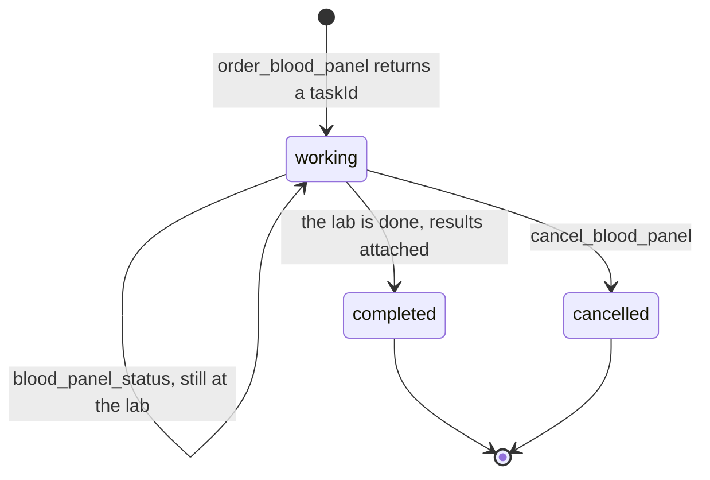

# Report lab results later

## The problem

The clinic now has a lab-results server. Dr Sam Reyes asks Claude to order a blood panel for Biscuit (P-0001). A
real panel takes about 40 minutes. The starter's `order_blood_panel` waits for the whole panel before it answers.
So the model waits, the host waits, and Dr Reyes waits. A host can also give up on a slow tool call.

The fix is a task handle: an id the server returns at once, so the client can ask about the work later.

For example, the first call returns at once:

```text
Ordered a blood panel for Biscuit. Task LAB-0001 is working. Ask blood_panel_status with this taskId in a few minutes.
```

A little later, `blood_panel_status` with `LAB-0001` says `Task LAB-0001 is completed. PCV 45 %, ALT 52 U/L,
Creatinine 98 umol/L`.



## Your challenge

The lab is `../lab/lab.ts`. You do not edit it. It has `orderBloodPanel`, `status`, `results` and `cancel`.

1. Change `order_blood_panel`, so it starts the panel and returns at once. Return `structuredContent` of
   `{ taskId, status: "working" }`, with an `outputSchema`.
2. Add `blood_panel_status`. It takes `taskId` and returns `working`, `completed` or `cancelled`. Once the task
   is completed, it adds the results.
3. Add `cancel_blood_panel`. It takes `taskId`, calls `lab.cancel`, and returns the new status.
4. An unknown `taskId` is an error that names it.

The lab takes 3 seconds here. Try the first call:

```bash
bun run try --server parts/05-grow-the-server/02-report-lab-results-later/problem order_blood_panel '{"patientId":"P-0001"}'
```

Expect: `Result from order_blood_panel:` at once, with a taskId. The starter waits 3 seconds and prints the panel.

If you already know this: the 2026-07-28 protocol moved tasks to an extension, `@modelcontextprotocol/ext-tasks`,
with `tasks/get` and `tasks/cancel`. The server SDK used here has no server side for it yet. So this step builds
the same idea with tools, and any client can use them.

## Done when

- `order_blood_panel` answers in under one second, while the lab still works.
- Its structured result has a `taskId` and status `"working"`.
- `blood_panel_status` says working at first, then completed with the lab's results.
- `cancel_blood_panel` stops a working task, and it stays cancelled.
- An unknown `taskId` gets an error that names it.

```bash
bun run verify report-lab-results-later
```

Expect: `Done. All 5 rules pass.` once your work meets every Done when line. Before that, each FAIL line has a `Try next:`.

## If you get stuck

- The order is still slow: you call `lab.waitForResults`. Call `lab.orderBloodPanel` and return.
- The cancelled task turns completed later: your tool says "cancelled" but never calls `lab.cancel`.
- The check sets `LAB_TURNAROUND_MS` to 1.5 seconds and asks again after that time.

## Words you will use

- **Task handle**: an id for work that is still running, so a client can ask about it later.
- **Polling**: asking again and again until the work is done.
- **Turnaround**: how long the lab needs before results are ready.
