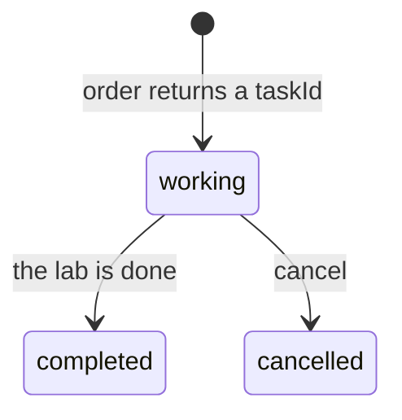

# Report lab results later

## The problem

For example, Dr Sam Reyes asks Claude to order a blood panel for Biscuit (P-0001). The starter tool waits for the whole panel, 3 seconds here and far longer in a real lab. A host can give up on a slow call. The fix is a task handle: an id the server returns at once.



## Watch it done

Before, the order tool waits, then prints the panel:

```text
Result from order_blood_panel:
Blood panel for Biscuit: PCV 45 %, ALT 52 U/L, Creatinine 98 umol/L
```

```text
0 of 5 rules pass. The order took 2287 ms.
```

After, the order answers at once with a task id, and a later call reports the results:

```text
Ordered a blood panel for Biscuit. Task LAB-0001 is working. Ask blood_panel_status with this taskId in a few minutes.
```

`bun run verify report-lab-results-later solution` prints `Done. All 5 rules pass.`

## Your turn

1. Run the starter and watch it wait.

```bash
bun run try --server parts/05-grow-the-server/02-report-lab-results-later/problem order_blood_panel '{"patientId":"P-0001"}'
```

Expect: a pause, then the full panel.

2. In `server.ts`, make `order_blood_panel` start the panel with `lab.orderBloodPanel` and return at once. Return `structuredContent` of `taskId` and `status: "working"`, with an `outputSchema`. The lab code is `../lab/lab.ts`; do not edit it.
3. Add `blood_panel_status`. It takes `taskId` and returns working, completed or cancelled, with the results once completed.
4. Add `cancel_blood_panel`. It calls `lab.cancel` and returns the new status.
5. Return an error that names an unknown `taskId`.
6. Run the first command again.

Expect: the "Ordered a blood panel" text with a task id, with no wait.

## Do it on your work

Pick one slow job in your own server, such as a report or an export. Return an id at once and add one status tool. Good looks like a first answer in under a second, and a status that moves from working to done.

## Done when

- `order_blood_panel` answers in under one second.
- Its result has a `taskId` and status `working`.
- `blood_panel_status` says working, then completed with results.
- `cancel_blood_panel` stops a task, and it stays cancelled.
- An unknown `taskId` gets an error that names it.

```bash
bun run verify report-lab-results-later
```

Expect: `Done. All 5 rules pass.`

## Solution

The after state is one `server.ts` with three tools. See `solution/server.ts`.

## Go further

The newest protocol moved tasks to an extension, `@modelcontextprotocol/ext-tasks`, with `tasks/get` and `tasks/cancel`. The server SDK used here has no server side for it yet. So this step builds the same idea with tools, and any client can use them.

## If you get stuck

- The order is still slow: you call `lab.waitForResults`. Call `lab.orderBloodPanel` and return.
- A cancelled task turns completed: your tool never calls `lab.cancel`.

## Words you will use

- **Task handle**: an id for work that is still running.
- **Polling**: asking again and again until the work is done.
- **Turnaround**: how long the lab needs before results are ready.
