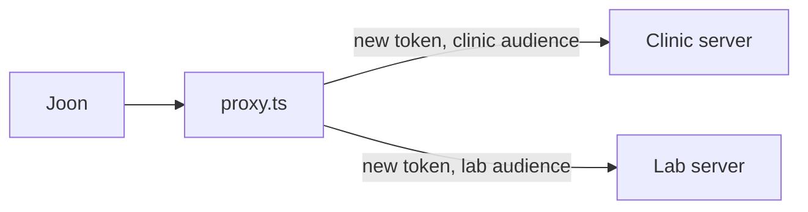

# Front two servers

## The problem

The lab team wants one address for two servers. A proxy, a small server that passes calls on, gives them that. For example, a careless proxy sends Joon's own token on, though it was made for the proxy. An upstream, a server behind the proxy, must refuse it.



## Watch it done

Before, the starter proxy passes Joon's token on and lists every lab tool:

```text
FAIL  The unpinned lab tool export_all_results does not appear
FAIL  Each upstream received only tokens minted for its own address
FAIL  No upstream ever received a token minted for the proxy
3 of 7 rules pass.
```

After, the clinic server's log shows a token made for the clinic:

```text
{"server":"clinic","audience":"http://127.0.0.1:8801/mcp","subject":"S-01"}
```

`bun run verify front-two-servers solution` prints `Done. All 7 rules pass.`

## Your turn

1. In `upstream.ts`, find `tokenFor`. It returns `caller.inboundToken`. Delete that line, so it always mints a new token with `audience: upstream.url`.
2. In `proxy.ts`, find the TODO. Keep only the lab tools whose `fingerprint(tool)` is in `pinned`. Print each dropped tool.
3. Run the check. It starts both upstreams and your proxy itself.

```bash
bun run verify front-two-servers
```

Expect: `Done. All 7 rules pass.`

## Do it on your work

List two servers you use, and write which tools you would let through from each. Good looks like a short list per server, with every new tool left out until a person has read it. Then name the audience each server should trust.

## Done when

- The proxy refuses a request with no token (401).
- Clinic tools have the `clinic_` prefix, and pinned lab tools the `lab_` prefix.
- `export_all_results` does not appear.
- Calls go through and show real slots and a task.
- Each upstream received only tokens made for its own address, and never one made for the proxy.

## Solution

The after state mints a token per upstream and filters by pins. See `solution/upstream.ts` and `solution/proxy.ts`.

## Go further

To run it by hand, use three terminals. Start the clinic upstream with `PORT=8801 bun parts/05-grow-the-server/03-front-two-servers/upstreams/clinic.ts`. Start `lab.ts` the same way on port 8802. Then start the proxy with `PORT=8800`, `CLINIC_URL` and `LAB_URL` set. Expect a line that says the proxy serves 10 tools. The starter serves 11.

In a real clinic, the sign-in server swaps one token for another (token exchange). Here the course's signing key stands in for it.

## If you get stuck

- Listing works but calls fail: calls still pass Joon's token on.

## Words you will use

- **Proxy**: a server in front of other servers.
- **Audience**: the server a token was made for.
- **Token passthrough**: sending on a token you received. The MCP spec forbids it.
