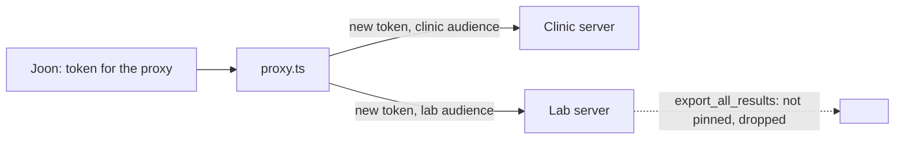

# Front two servers

## The problem

The lab team wants one address for both servers: the clinic server and the lab-results server. A proxy can give
them that. A proxy is a small server that sits in front of other servers and passes calls on.

A careless proxy brings back two old dangers:

- **Token passthrough**: it sends the caller's own token on. That token was minted for the proxy. An upstream
  must refuse it, and the MCP spec says a server must not pass tokens through.
- **New tools nobody reviewed**: the lab's latest release added `export_all_results`. It sends every result, with
  owner details, to any address. Nobody at the clinic has read it, so it is not in `pins.json`.

For example, Joon calls `clinic_find_free_slots` on the proxy. The proxy mints a new token for the clinic server,
with the clinic's address as the audience. The clinic server's log then shows:

```text
{"server":"clinic","audience":"http://127.0.0.1:8801/mcp","subject":"S-01"}
```



## Your challenge

The two upstream servers are in `../upstreams/`. You do not edit them. Your proxy is `proxy.ts`, with
`upstream.ts` and `pins.ts`. It already adds the prefixes `clinic_` and `lab_`. Fix its two TODOs:

1. In `upstream.ts`, `tokenFor` sends the caller's own token on. Mint a new token for every upstream call, with
   the upstream's URL as the audience.
2. In `proxy.ts`, keep only the lab tools whose fingerprint is in `pins.json`.

Run it yourself in three terminals, from the repo root:

```bash
PORT=8801 bun parts/05-grow-the-server/03-front-two-servers/upstreams/clinic.ts
```

Expect: `clinic upstream listening on http://127.0.0.1:8801/mcp`

```bash
PORT=8802 bun parts/05-grow-the-server/03-front-two-servers/upstreams/lab.ts
```

Expect: `lab upstream listening on http://127.0.0.1:8802/mcp`

```bash
cd parts/05-grow-the-server/03-front-two-servers/problem && PORT=8800 CLINIC_URL=http://127.0.0.1:8801/mcp LAB_URL=http://127.0.0.1:8802/mcp bun proxy.ts
```

Expect: `The proxy serves 10 tools on http://127.0.0.1:8800/mcp` once the pin filter works. The starter serves 11.

If you already know this: in a real clinic, the authorization server swaps one token for another (token exchange).
Here the course's signing key stands in for it.

## Done when

- The proxy starts, and refuses a request with no token (401).
- Clinic tools have the `clinic_` prefix, such as `clinic_find_free_slots`.
- Pinned lab tools have the `lab_` prefix: `lab_order_blood_panel` and `lab_blood_panel_status`.
- The unpinned lab tool `export_all_results` does not appear.
- Calls go through: `clinic_find_free_slots` shows real free slots, `lab_order_blood_panel` a task.
- Each upstream received only tokens minted for its own address.
- No upstream ever received a token minted for the proxy.

```bash
bun run verify front-two-servers
```

Expect: `Done. All 7 rules pass.` once your work meets every Done when line. Before that, each FAIL line has a `Try next:`.

## If you get stuck

- Listing works but every call fails: the list at start uses a minted token, but calls still pass Joon's token on.
- The check starts the upstreams and your proxy on free ports, and reads each upstream's token log.

## Words you will use

- **Proxy**: a server in front of other servers, which passes calls on.
- **Upstream**: a server behind the proxy.
- **Audience**: the server a token was minted for. A server refuses a token for any other audience.
- **Token passthrough**: sending on a token you received. The MCP spec forbids it.
