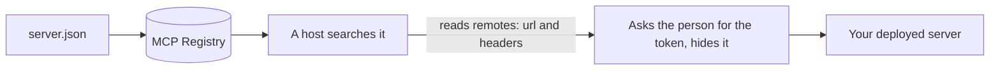

# Publish to the registry

## The problem

Other clinics in the group want to find the Harrow Lane server without asking you for the address. The MCP
Registry is a public list of MCP servers. A host can search it, read how to connect, and ask the person for any
setting it needs. Each server describes itself in one file, `server.json`.

A `server.json` can be valid and still wrong. For example, the starter has three problems:

```json
{
  "name": "Harrow Lane server",
  "version": "latest",
  "remotes": [{ "type": "streamable-http", "url": "TODO" }]
}
```

The name has a space and no namespace. "latest" is not one exact version. And the remote has no real address, and
says nothing about the token the server needs.



## Your challenge

Fix `server.json`. You do not publish anything in this step.

1. `name`: a namespace you own, a slash, then a short name. For example `io.github.<your GitHub name>/harrow-lane`.
2. `description`: one sentence, 100 characters at most.
3. `version`: one exact version, such as `1.0.0`.
4. `remotes`: one `streamable-http` entry with your address from `deploy-the-server`. It must be https and end in
   `/mcp`.
5. Under that remote, add `headers` with one `Authorization` header. Mark it `"isRequired": true` and
   `"isSecret": true`. Then a host asks the person for the token and never shows it on screen.

The registry's schema is in `../registry/server.schema.json`. It is a copy of version 2025-12-11 from
`https://static.modelcontextprotocol.io/schemas/2025-12-11/server.schema.json`, read for this course.

If you already know this: a real publish uses the registry's `mcp-publisher` tool and proves you own the namespace.
Keep that for your own server.

## Done when

- `server.json` matches the MCP Registry schema (2025-12-11).
- Its `$schema` names the 2025-12-11 server schema.
- Its name is a namespace and a server name, such as `io.github.<you>/harrow-lane`.
- Its version is one exact version, such as `1.0.0`, never a range or latest.
- It has a `streamable-http` remote at a public https address ending in `/mcp`.
- The remote asks for an `Authorization` header that is required and secret.

```bash
bun run verify publish-to-the-registry
```

Expect: `Done. All 6 rules pass.` once your work meets every Done when line. Before that, each FAIL line has a `Try next:`.

## If you get stuck

- The schema rule fails: its `Try next:` line quotes the schema's own message, such as `data/name must match pattern`.
- Your address is `127.0.0.1`: nobody else can reach your laptop. Use the address from your deploy.

## Words you will use

- **MCP Registry**: a public list of MCP servers that hosts can search.
- **`server.json`**: the file that describes one server for the registry: name, version and how to connect.
- **Namespace**: the part of the name before the slash. It shows who owns the server.
- **Secret header**: a setting a host asks for and never shows, such as a token.
