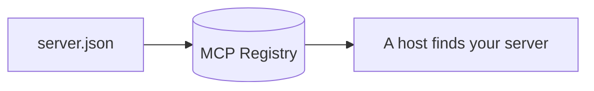

# Publish to the registry

## The problem

Other clinics want to find the Harrow Lane server without asking for its address. The MCP Registry is a public list of servers, and each describes itself in one file, `server.json`. For example, the starter has the name Harrow Lane server, with spaces, and the version latest. Both are invalid.



## Watch it done

Before, the check quotes the schema's own complaints:

```text
FAIL  server.json matches the MCP Registry schema (2025-12-11)
      Try next: fix what the schema says: data/name must match pattern "^[a-zA-Z0-9.-]+/[a-zA-Z0-9._-]+$", ...
FAIL  Its version is one exact version, such as 1.0.0, never a range or latest
FAIL  The remote asks for an Authorization header that is required and secret
1 of 6 rules pass.
```

After, it prints `Done. All 6 rules pass.`

## Your turn

1. Open `server.json` in this step's `problem/` folder. Change `name` to a namespace you own, a slash, then a short name: `io.github.<your GitHub name>/harrow-lane`.
2. Write `description` as one sentence of 100 characters or fewer.
3. Change `version` to one exact version, such as `1.0.0`.
4. In `remotes`, set the `streamable-http` url to a public https address that ends in `/mcp`.
5. Under that remote, add this header, so a host asks the person for the token and never shows it:

```json
"headers": [{ "name": "Authorization", "isRequired": true, "isSecret": true }]
```

6. Run the check.

```bash
bun run verify publish-to-the-registry
```

Expect: `Done. All 6 rules pass.`

## Do it on your work

Write a `server.json` for a server of your own. Use an address people outside your laptop can reach, never `127.0.0.1`. Good looks like a name you own, one exact version and a secret header for any token. Do not publish yet.

## Done when

- `server.json` matches the registry schema.
- Its `$schema` names the 2025-12-11 server schema.
- Its name is a namespace and a server name.
- Its version is one exact version.
- It has a `streamable-http` remote at a public https address ending in `/mcp`.
- The remote asks for a required, secret `Authorization` header.

## Solution

The after state is one valid `server.json`. See `solution/server.json`.

## Go further

The registry's schema is in `../registry/server.schema.json`. A real publish uses the `mcp-publisher` tool and proves you own the namespace. Keep that for your own server.

## If you get stuck

- The schema rule fails: its `Try next:` line quotes the schema, such as `data/name must match pattern`.
- Your address is `127.0.0.1`: use the address from your deploy.

## Words you will use

- **MCP Registry**: a public list of MCP servers that hosts can search.
- **Namespace**: the part of the name before the slash. It shows who owns the server.
- **Secret header**: a setting a host asks for and never shows, such as a token.
