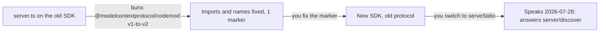

# Upgrade an old server

## The problem

The Millbrook branch still runs an old diary server. It was built on version 1 of the MCP TypeScript SDK. That is
the package `@modelcontextprotocol/sdk`. This repo has version 2, so the old server does not start.

Version 2 moved and renamed many things. For example, the old server starts like this:

```typescript
import { McpServer } from "@modelcontextprotocol/sdk/server/mcp.js";
server.tool(
  "find_free_slots",
  "List free appointment start times...",
  { site: z.enum(SITES) },
  handler,
);
```

In version 2, the import is `@modelcontextprotocol/server`, and `.tool()` becomes `registerTool`. A codemod is a
tool that rewrites code for you. The SDK team ships one for this job. It cannot fix it all. Where it is not sure, it
leaves a comment that starts with `@mcp-codemod-error`.



## Your challenge

1. Run the codemod on the old server:

```bash
cd parts/05-grow-the-server/05-upgrade-a-v1-server/problem && bunx @modelcontextprotocol/codemod@2.4.0 v1-to-v2 server.ts
```

Expect: `Changes: 6 across 1 file(s)` and `1 location(s) marked with @mcp-codemod-error comments`.

2. Find the marker: `grep -n @mcp-codemod-error server.ts`. Read the call below it. The codemod read the old
   call wrongly. The description went into `inputSchema`, and the fields went into `annotations`. Move the
   description to `description`. Wrap the fields in `z.object({ ... })` as `inputSchema`. Then delete the marker.
3. The codemod moves you to the new SDK, not to the new protocol. The server still calls `server.connect`, so it
   speaks only 2025-11-25. Put the server in a `createServer()` function. Start it with `serveStdio(createServer)`,
   as in Part 1.
4. Run `bun run format` to tidy up the new code.

If you already know this: the codemod's own README lists what it does not cover. The 2026-07-28 protocol is one.

## Done when

- No import from the old `"@modelcontextprotocol/sdk"` package is left.
- No `@mcp-codemod-error` marker is left.
- Every rule of `expose-the-diary` from Part 1 passes, shown as `Part 1: ...` lines.

```bash
bun run verify upgrade-a-v1-server
```

Expect: `Done. All 10 rules pass.` once your work meets every Done when line. Before that, each FAIL line has a `Try next:`.

## If you get stuck

- The rule about speaking the current spec fails: you still call `server.connect`. Use `serveStdio`.
- The server does not start: look at the marker. `inputSchema` must be a schema, not a sentence.
- Want to start again? Run `git checkout` on the folder, then run the codemod once more.

## Words you will use

- **SDK**: the library that does the protocol work for you. Here it is the MCP TypeScript SDK.
- **Codemod**: a program that rewrites your code for a new version of a library.
- **Marker**: a note the codemod leaves where a person must decide.
