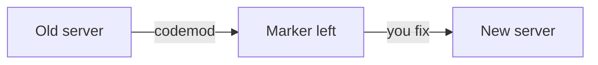

# Upgrade an old server

## The problem

The Millbrook branch runs a diary server on the old MCP TypeScript SDK, the library that does the protocol work. For example, its import is `@modelcontextprotocol/sdk`, which this repo no longer has. A codemod, a tool that rewrites code, does most of the move.



## Watch it done

Before, the old server cannot load its package:

```text
2 of 10 rules pass.
FAIL  No import from the old "@modelcontextprotocol/sdk" package is left
FAIL  Part 1: The server starts over stdio and answers an MCP client
      The checker saw: error: Cannot find module '@modelcontextprotocol/sdk/server/mcp.js'
```

After, it prints `Done. All 10 rules pass.` The new server also answers `server/discover`.

## Your turn

1. Run the codemod on the old server.

```bash
cd parts/05-grow-the-server/05-upgrade-a-v1-server/problem && bunx @modelcontextprotocol/codemod@2.4.0 v1-to-v2 server.ts
```

Expect: `Changes: 6 across 1 file(s)` and `1 location(s) marked with @mcp-codemod-error comments`.

2. Find the marker with `grep -n @mcp-codemod-error server.ts`. The codemod misread the old call. Move the sentence to `description`. Wrap the fields in `z.object({ ... })` as `inputSchema`. Delete the marker.
3. Put the server in a function `createServer()`. Start it with `serveStdio(createServer)` in place of `server.connect`.
4. Tidy up, then check.

```bash
bun run format
bun run verify upgrade-a-v1-server
```

Expect: `Done. All 10 rules pass.`

## Do it on your work

Find one server of yours on the old SDK, or one tool you wrote by hand. Run the codemod on a copy, then count its markers. Good looks like zero old imports, zero markers and a server that starts. If you have none, read the codemod's README and note three things it leaves to you.

## Done when

- No import from the old `"@modelcontextprotocol/sdk"` package is left.
- No `@mcp-codemod-error` marker is left.
- Every rule of `expose-the-diary` passes, shown as `Part 1: ...` lines.

## Solution

The after state is a `server.ts` with `registerTool`, a `createServer()` function and `serveStdio`. See `solution/server.ts`.

## Go further

The codemod moves you to the new SDK, not to the new protocol. The server still speaks the old protocol until you use `serveStdio`.

## If you get stuck

- The rule about the current spec fails: you still call `server.connect`.
- The server does not start: `inputSchema` must be a schema, not a sentence.
- Want to start again? Run `git checkout` on the folder, then run the codemod once more.

## Words you will use

- **SDK**: the library that does the protocol work for you.
- **Codemod**: a program that rewrites your code for a new library version.
- **Marker**: a note the codemod leaves where a person must decide.
