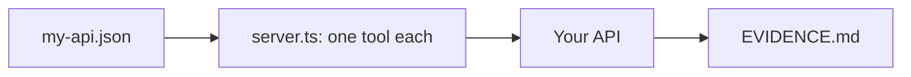

# Wrap your own API

## The problem

Most web APIs map to tools the same way: one endpoint, one tool. For example, a shop's `GET /orders/{orderId}` becomes `get_order`. A `DELETE` becomes `cancel_order`, marked destructive so a client asks first. The check judges your own API, not the clinic.



## Watch it done

Before, the starter has only TODOs:

```text
FAIL my-api.json describes your own API: no TODO, a read endpoint, and well formed endpoints
FAIL EVIDENCE.md has your API, one real call that matches an endpoint, and what you left out
6 of 8 rules pass.
```

After, the sample for a small book shop passes every rule, and the evidence shows one real call:

```text
Done. All 8 capstone rules pass.
```

```text
tool: get_order
request: GET /orders/ORD-1041
status: 200
```

## Your turn

1. Pick an API you can reach with a test key. Never use a real production key.
2. Open `my-api.json`. Replace every `TODO`. List two endpoints, one a `GET`. Give each a short name such as `get_order`, a method and a path with `{orderId}` where a value goes. Add a description that says when to use it.
3. Keep `server.ts` as it is. It makes one tool per endpoint and reads `MY_API_URL` and `MY_API_TOKEN`.
4. Call one tool against your real API.

```bash
bun run try --server parts/05-grow-the-server/06-wrap-your-own-api/problem get_order '{"orderId":"ORD-1041"}'
```

Expect: a result from your API, or an error text the model can read.

5. Fill in `EVIDENCE.md`: your API, the real call and one endpoint you left out.

## Do it on your work

Steps 1 to 5 are the work: the files in this folder are yours. Check any folder with the capstone command.

```bash
bun capstone/check.ts parts/05-grow-the-server/06-wrap-your-own-api/problem
```

Expect: `Done. All 8 capstone rules pass.` once your own files are done. Good looks like tools you would let a new colleague use.

## Done when

- `my-api.json` has no `TODO`, one read endpoint and well formed endpoints.
- The endpoints are not the clinic's tools.
- There is one tool for each endpoint, with its description.
- A `GET` tool is read-only and a `DELETE` tool is destructive.
- The key goes in the `Authorization` header, never in a tool input or an answer.
- A failed call gives an error the model can read.
- `EVIDENCE.md` has your API, one real call and one endpoint left out.

```bash
bun run verify wrap-your-own-api
```

Expect: `Done. All 8 rules pass.`

## Solution

The after state is three files. See `solution/my-api.json`, `solution/server.ts` and `solution/EVIDENCE.md`. A copy of the starter is in `capstone/template`, and of the solution in `capstone/sample`.

## Go further

Add a third endpoint that writes data, and check that its tool is neither read-only nor destructive.

## If you get stuck

- The path check fails: every `{name}` in a path needs a value of the same name, with `"in": "path"`.
- The key check fails: a value called `token` or `key` must not be a tool input.
- The evidence check fails: the `request:` line starts with the method of the tool you named.

## Words you will use

- **Endpoint**: one address and method of a web API, such as `GET /orders`.
- **Test key**: a key for a practice copy of the system.
- **Evidence**: proof you ran it for real.
