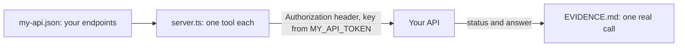

# Wrap your own API

## The problem

You have built a server for the clinic's diary. Now do the same for a system you really use at work. It might be
an order system, a ticket tracker or a booking tool. You do not need new code for each one. Most web APIs map to
tools the same way: one endpoint, one tool.

For example, a shop's `GET /orders/{orderId}` becomes a tool called `get_order`. A `DELETE /orders/{orderId}` becomes
`cancel_order`, and it is marked destructive so a client asks first.

This step is judged on your own files. The check never reads the clinic. It stands in for your API, so it can prove
the shape of your work. Your `EVIDENCE.md` shows the real call.



## Your challenge

1. Pick an API you can reach with a test key. Do not use a real production key.
2. Open `my-api.json`. Replace every `TODO`. List at least two endpoints, and make one a `GET`. Give each a short
   name like `get_order`, a method, a path with `{name}` where a value goes, and its values. The description says
   what it does and when to use it.
3. Leave `server.ts` as it is, or improve it. It turns each endpoint into a tool, and reads `MY_API_URL` and
   `MY_API_TOKEN` from the environment.
4. Run your server against your real API with your test key. Call one tool with `bun run try --server` and the
   folder.
5. Open `EVIDENCE.md`. Fill in your API, paste what the real call showed, and name one endpoint you left out and why.

## Done when

- `my-api.json` describes your own API: no `TODO`, a read endpoint, and well formed endpoints.
- The endpoints are not the clinic's tools.
- The server lists one tool for each endpoint, with its description.
- A `GET` tool is read-only, a `DELETE` tool is destructive, and writes are neither.
- Each tool sends the right method and path to the API, with its values filled in.
- The key goes in the `Authorization` header, and never in a tool input or an answer.
- A failed API call gives an error answer the model can read, and the server keeps running.
- `EVIDENCE.md` has your API, one real call that matches an endpoint, and what you left out.

```bash
bun run verify wrap-your-own-api
```

Expect: `Done. All 8 rules pass.` once your work meets every Done when line. Before that, each FAIL line has a `Try next:`.

## If you get stuck

- The path check fails: every `{name}` in a path needs a value of the same name, with `"in": "path"`.
- The key check fails: a value called `token` or `key` must not be a tool input. The model must never see the key.
- The evidence check fails: the `request:` line starts with the method of the tool you named.

## Words you will use

- **Endpoint**: one address and method of a web API, such as `GET /orders`.
- **Test key**: a key for a practice copy of the system, so a mistake costs nothing.
- **Evidence**: proof you ran it for real, so the check can see it.
