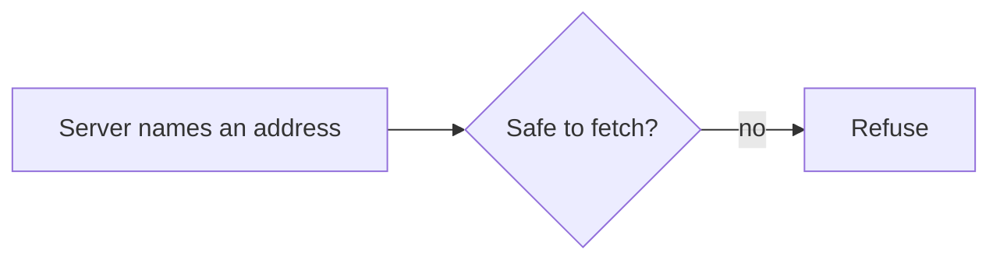

# Secure the client

## The problem

A client goes where a server tells it. For example, a bad server names `https://169.254.169.254/`, the cloud metadata service that holds secrets. That trick is SSRF: the server makes the client send a request for it. A client with no guard follows.



## Watch it done

Before, every guard in `guards.ts` allows everything:

```text
FAIL  An address that points inside, or is not plain https, is refused
      First wrong answer: plain http
FAIL  The iss check accepts a match and refuses a missing, wrong or look-alike iss
FAIL  Our client ID document is accepted when it is good and refused when it is not
1 of 4 rules pass.
```

After, it prints `Done. All 4 rules pass.`

## Your turn

1. Open `guards.ts` in this step's `problem/` folder. In `checkFetchUrl`, refuse anything that is not plain https. Refuse an address with a name and password.
2. Refuse `localhost`, names ending in `.local` or `.internal`, and private or link-local numbers.
3. Run the check.

```bash
bun run verify secure-the-client
```

Expect: the `iss` rule and the client ID rule still show `FAIL`.

4. In `checkIssuer`, when the server promised an `iss`, refuse a missing one. Refuse one that is not exactly the issuer in the metadata.
5. In `checkClientMetadata`, require a client ID that is the https address of the document, with a path. Require `token_endpoint_auth_method` to be `none`. Require https redirects, or http on this machine.
6. Run the check again.

Expect: `Done. All 4 rules pass.`

## Do it on your work

Find one place where your own code or agent fetches an address that someone else supplied. Write down which of these guards it has. Good looks like a refused private address and a test that proves it.

## Done when

- A public https address is fetched.
- An address that points inside, or is not plain https, is refused.
- The `iss` check accepts a match and refuses a missing, wrong or look-alike one.
- A good client ID document is accepted, and a bad one refused.

## Solution

The after state is a `guards.ts` with three working guards. See `solution/guards.ts`.

## Go further

Read the OWASP guide on SSRF, and the IETF draft for Client ID Metadata Documents. It says a server must not fetch an address that points to a special-use number. That is the rule you just wrote.

## If you get stuck

- `https://2130706433/` gets through: the URL class turns it into `127.0.0.1`. Check the host it gives you.
- `https://[::ffff:127.0.0.1]/` gets through: refuse IPv6 addresses that wrap an IPv4 one.
- A look-alike `iss` gets through: use `!==`, not `startsWith`.

## Words you will use

- **SSRF**: a trick where a server makes a client fetch an address the server chose.
- **`iss`**: the issuer value in a sign-in answer. It says who sent it.
- **Client ID Metadata Document**: a file at an https address that describes a client. The address is the client ID.
- **Link-local**: an address that only works on the local network.
