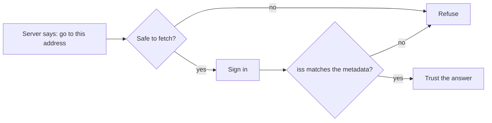

# Secure the client

## The problem

A client trusts what a server tells it. The server says "sign in at this address", and the client goes there. A
bad server can name an address inside your network, such as `https://169.254.169.254/`. That is the cloud
metadata service, and it holds secrets. This attack is called SSRF: the server tricks the client into making a
request for it.

For example, the lab's server returns metadata that points to `https://10.0.0.5/`. A client with no guard fetches
it from inside the clinic network.

Two more guards keep sign-in honest. The `iss` value in a sign-in answer says who sent it. A client that skips it
can be fooled into sending a code to the wrong server. A Client ID Metadata Document is a small file the client
hosts at an https address, and that address is its client ID.



## Your challenge

1. Open `guards.ts`. Each guard allows everything today.
2. In `checkFetchUrl`, refuse anything that is not plain https. Refuse an address with a name and password. Refuse
   `localhost`, names that end in `.local` or `.internal`, and private or link-local numbers, in both the old and
   the new style.
3. In `checkIssuer`, when the server promised an `iss`, refuse a missing one. Refuse one that is not exactly the
   issuer in the metadata.
4. In `checkClientMetadata`, require a client ID that is the https address of the document, with a path. Require
   `token_endpoint_auth_method` to be `none`. Require redirect addresses that are https, or http on this machine.

## Done when

- A public https address is fetched.
- An address that points inside, or is not plain https, is refused.
- The `iss` check accepts a match and refuses a missing, wrong or look-alike `iss`.
- Our client ID document is accepted when it is good and refused when it is not.

```bash
bun run verify secure-the-client
```

Expect: `Done. All 4 rules pass.` once your work meets every Done when line. Before that, each FAIL line has a `Try next:`.

## If you get stuck

- `https://2130706433/` gets through: the URL class turns it into `127.0.0.1`. Check the host it gives you.
- `https://[::ffff:127.0.0.1]/` gets through: refuse IPv6 addresses that wrap an IPv4 one.
- A look-alike `iss` gets through: use `!==`, not `startsWith`.

## Words you will use

- **SSRF**: a trick where a server makes a client fetch an address the server chose.
- **`iss`**: the issuer value in a sign-in answer. It says who sent the answer.
- **Client ID Metadata Document**: a file at an https address that describes a client. The address is the client ID.
- **Link-local**: an address that only works on the local network, such as `169.254.169.254`.
