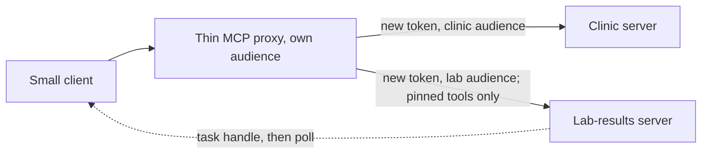

# Grow the server

## The problem

A year later, the clinic group grows, and the server must grow too:

- the group adds a lab-results service;
- a second team wants one URL for both servers;
- blood results take minutes to come back, so a tool cannot wait for them;
- some old servers still run on the previous SDK.

This is an extension part. It grows the server and keeps everything Parts 1 to 4 proved.

For example, Dr Sam Reyes orders a blood panel for Biscuit (P-0001). The lab needs a few minutes. So
`order_blood_panel` returns a task handle at once: an id the client can ask about later, such as `LAB-0001`. The
client asks `blood_panel_status` again until the task moves from working to completed.

## Why it matters

Every tool a host loads costs context before any work starts. Context is the text the model reads on each turn.

Anthropic measured one setup with several servers. The tool definitions alone took about 77K tokens before any work.
When tools were loaded only when needed, they took about 8.7K tokens
([Introducing advanced tool use](https://www.anthropic.com/engineering/advanced-tool-use), read for this course).

So when you put two servers behind one front, you must keep that cost under control. You must also keep the trust
boundary: each server only trusts tokens made for it.

The diagram shows the plan. A thin proxy sits in front. It gets a new token for each server behind it, and it lets
through only pinned lab tools.



## Steps

| Step                       | Minutes | You produce                                                                   | The check reads                                                                           |
| -------------------------- | ------- | ----------------------------------------------------------------------------- | ----------------------------------------------------------------------------------------- |
| `build-a-small-client`     | 20      | `client.ts`: discover, list and call, with version negotiation                | its output against the Part 1 server and the lab's old 2025-11-25 server                  |
| `report-lab-results-later` | 20      | `order_blood_panel` that returns a task handle, plus status and cancel tools  | how fast the order answers; the task moving from working to completed; cancel             |
| `front-two-servers`        | 25      | a proxy that prefixes tools, mints a token per upstream, drops unpinned tools | the tool list through the proxy; each upstream's log of the token audiences it received   |
| `publish-to-the-registry`  | 15      | a valid `server.json` for the MCP Registry, no real publish                   | the file against the registry's 2025-12-11 schema, plus version, address and secret token |
| `upgrade-a-v1-server`      | 15      | an old SDK server moved to the new SDK with the codemod, then fixed by hand   | no old import, no `@mcp-codemod-error`, and every `expose-the-diary` rule                 |
| `wrap-your-own-api`        | 30      | `my-api.json`, a server of tools from it, and `EVIDENCE.md` of one real call  | tools, annotations, the requests a stand-in API receives, a failed call, the evidence     |
| `secure-the-client`        | 20      | `guards.ts`: refuse unsafe addresses, check `iss`, check the client ID file   | each guard run on good and bad cases: private addresses, a wrong `iss`                    |

Each step has its own starter in `problem/`, so you can start any step fresh, in any order.

## Walkthrough

Talk to two servers that speak different protocol versions:

```bash
bun run verify build-a-small-client
```

Expect: `Done. All 5 rules pass.` once your work meets every Done when line. Before that, each FAIL line has a `Try next:`.

Return a task handle instead of waiting for the lab:

```bash
bun run verify report-lab-results-later
```

Expect: `Done. All 5 rules pass.` once your work meets every Done when line. Before that, each FAIL line has a `Try next:`.

Put both servers behind one proxy:

```bash
bun run verify front-two-servers
```

Expect: `Done. All 7 rules pass.` once your work meets every Done when line. Before that, each FAIL line has a `Try next:`.

Describe your server for the registry:

```bash
bun run verify publish-to-the-registry
```

Expect: `Done. All 6 rules pass.` once your work meets every Done when line. Before that, each FAIL line has a `Try next:`.

Upgrade the old Millbrook server:

```bash
bun run verify upgrade-a-v1-server
```

Expect: `Done. All 10 rules pass.` once your work meets every Done when line. Before that, each FAIL line has a `Try next:`.

Wrap your own API, with your own evidence: `bun run verify wrap-your-own-api`. Expect: `Done. All 8 rules pass.`

Make the client safe to trust a server: `bun run verify secure-the-client`. Expect: `Done. All 4 rules pass.`

```bash
bun run verify part grow-the-server
```

Expect: `Part grow-the-server is done: 7/7 steps pass.` once every step passes.

## Assignment

The problem: a lab-results service arrives, and a second team wants one address for both servers.

Hand in your repo with these files filled in:

- `01-build-a-small-client/problem/client.ts`;
- `03-front-two-servers/problem/` with `proxy.ts`, `upstream.ts` and `pins.json`.

How it is graded. Each line is yes or no:

1. Does `bun run verify build-a-small-client` pass, with both the new and the old server?
2. Does `bun run verify front-two-servers` pass, so no upstream ever sees a token minted for the proxy?

Extension for advanced learners: make each upstream token live 60 seconds. Pass `expiresIn: "60s"` when the proxy
mints it. Do the upstream logs show a token life of 60 seconds or less? Add `exp` and `iat` to the log line to see.

## Finished

You now have a server that can grow:

- a small client that works with new and old servers;
- a lab tool that answers at once and reports later;
- one address for two servers, where each server only trusts tokens made for it, and new tools wait for review;
- a `server.json` that lets other clinics find your server;
- a way to move old servers to the new SDK and the new protocol.

For example, Joon now calls `lab_order_blood_panel` and `clinic_find_free_slots` through one address. The lab
server's log shows only tokens minted for the lab.

This is the end of the course. Your next step is your own server: pick a system at work, and walk it through the
same parts.
