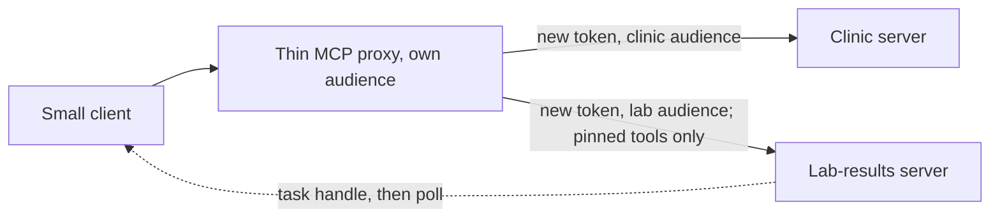

# Grow the server

## The problem

A year on, the group adds a lab-results service, a second team wants one URL for both servers, blood results take
minutes to come back, and old servers still run on the previous SDK. This extension part grows the server without
giving up anything Parts 1 to 4 proved.

## Why it matters

Every tool a host loads costs context before any work starts. Anthropic measured about 77K tokens of tool
definitions before any work in a multi-server setup, and about 8.7K once tools were loaded on demand
([Introducing advanced tool use](https://www.anthropic.com/engineering/advanced-tool-use)). Putting two servers
behind one front has to keep that cost and the trust boundary under control.



## Steps

| Step                       | Minutes | You produce                                                                      | The check reads                                                                  |
| -------------------------- | ------- | -------------------------------------------------------------------------------- | -------------------------------------------------------------------------------- |
| `build-a-small-client`     | 20      | a client that discovers, lists and calls, with version negotiation               | its output against your server and against a shipped legacy server               |
| `report-lab-results-later` | 20      | `order_blood_panel` that returns a task handle (tasks extension)                 | the task moving from working to completed; cancel works                          |
| `front-two-servers`        | 25      | a proxy that prefixes tools, mints a token per upstream and drops unpinned tools | the tool list through the proxy; upstream logs show each upstream's own audience |
| `publish-to-the-registry`  | 15      | a valid `server.json` for the MCP Registry, no real publish                      | the file against the registry schema                                             |
| `upgrade-a-v1-server`      | 15      | a shipped SDK v1 server moved to v2 with the codemod                             | Part 1 checks pass on it; no `@mcp-codemod-error` left                           |

Total: 95 minutes.

## Walkthrough

TODO(part session): one `bun run verify <step-name>` per step, each with its `Expect:` line.

```bash
bun run verify part grow-the-server
```

Expect: `Part grow-the-server is done: 5/5 steps pass.` once the part session has built the steps.
