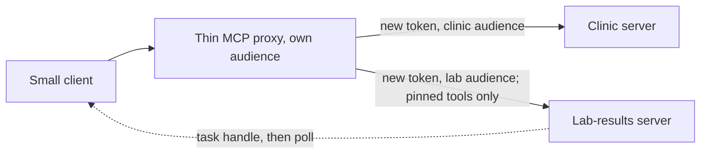

# Grow the server

## The problem

A year later, the clinic group grows, and the server must grow too:

- the group adds a lab-results service;
- a second team wants one URL for both servers;
- blood results take minutes to come back, so a tool cannot wait for them;
- some old servers still run on the previous SDK.

This is an extension part. It grows the server and keeps everything Parts 1 to 4 proved.

For example, Dr Sam Reyes orders a blood panel for Biscuit (P-0001). The lab needs a few minutes. So
`order_blood_panel` returns a task handle at once: an id the client can ask about later. The client asks again until
the task moves from working to completed.

## Why it matters

Every tool a host loads costs context before any work starts. Context is the text the model reads on each turn.

Anthropic measured one setup with several servers. The tool definitions alone took about 77K tokens before any work.
When tools were loaded only when needed, they took about 8.7K tokens
([Introducing advanced tool use](https://www.anthropic.com/engineering/advanced-tool-use)).

So when you put two servers behind one front, you must keep that cost under control. You must also keep the trust
boundary: each server only trusts tokens made for it.

The diagram shows the plan. A thin proxy sits in front. It gets a new token for each server behind it, and it lets
through only pinned lab tools.



## Steps

| Step                       | Minutes | You produce                                                                      | The check reads                                                                  |
| -------------------------- | ------- | -------------------------------------------------------------------------------- | -------------------------------------------------------------------------------- |
| `build-a-small-client`     | 20      | a client that discovers, lists and calls, with version negotiation               | its output against your server and against a shipped legacy server               |
| `report-lab-results-later` | 20      | `order_blood_panel` that returns a task handle (tasks extension)                 | the task moving from working to completed; cancel works                          |
| `front-two-servers`        | 25      | a proxy that prefixes tools, mints a token per upstream and drops unpinned tools | the tool list through the proxy; upstream logs show each upstream's own audience |
| `publish-to-the-registry`  | 15      | a valid `server.json` for the MCP Registry, no real publish                      | the file against the registry schema                                             |
| `upgrade-a-v1-server`      | 15      | a shipped SDK v1 server moved to v2 with the codemod                             | Part 1 checks pass on it; no `@mcp-codemod-error` left                           |

Total: 95 minutes.

## Walkthrough

TODO(part session): one `bun run verify <step-name>` per step, each with its `Expect:` line.

```bash
bun run verify part grow-the-server
```

Expect: `Part grow-the-server is done: 5/5 steps pass.` once the part session has built the steps.

A later build session adds the steps of this part. Until then, the table above shows what each step asks of you.
