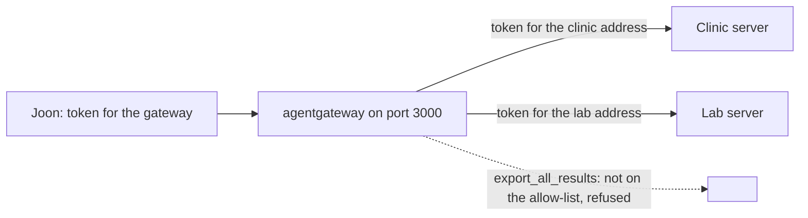

# Put the servers behind agentgateway

## The problem

Earlier you wrote a proxy by hand. It put the clinic server and the lab server behind one address.

Teams that run this in production often use a ready-made gateway instead. A gateway is a small program that sits in
front of your servers, checks who is calling and decides which tools they may use. Here you use agentgateway. You do
not write code. You write one `config.yaml`.

For example, Joon calls `clinic_find_free_slots` through port 3000. The gateway checks his token, finds the tool on
the allow-list, sends a token made for the clinic server, and returns the free slots. If he calls
`lab_export_all_results`, the gateway refuses.



## Your challenge

Work in the `assignment/` folder. It has a `compose.yml` that starts the gateway, the clinic server and the lab
server. It also has a starter `config.yaml` that knows only the clinic server and checks no token.

Make `config.yaml` do four things.

First, add the lab server as a second target, next to the clinic target:

```yaml
- name: lab
  mcp:
    host: http://127.0.0.1:8802/mcp
```

Second, add a `jwtAuth` rule to the route's policies, so a request with no token gets 401:

```yaml
jwtAuth:
  mode: strict
  issuer: https://login.harrowlane.test
  audiences: [http://127.0.0.1:3000/mcp]
  jwks:
    file: /run/keys/public-keys.jwks
```

Third, give each target a `backendAuth` key that points at its own token file in `/run/keys`:

```yaml
policies:
  backendAuth:
    key:
      value:
        file: /run/keys/clinic.token
```

Fourth, add `mcpAuthorization` rules that allow one read-only tool from each server, and nothing else. Inside a
rule, `mcp.tool.target` is the server name. The value `mcp.tool.name` is the tool's own name, without the prefix:

```yaml
mcpAuthorization:
  rules:
    - allow: 'mcp.tool.target == "clinic" && mcp.tool.name == "find_free_slots"'
```

Start it from the repo root:

```bash
bun assignment/token.ts
```

Expect: `Wrote the test key and tokens to` and the path of `assignment/.run`.

```bash
docker compose -f assignment/compose.yml up -d
```

Expect: three containers started: `clinic`, `lab` and `gateway`. Stop them later with `docker compose -f assignment/compose.yml down -v`.

## Done when

- The gateway image tag is `v1.7.0`.
- `tools/list` through the gateway shows tools from both servers.
- A request with no token is refused with 401.
- The allowed tool returns real free slots.
- A tool that is not on the allow-list returns an error.
- The tools list shows only the allowed tools.

```bash
bun run verify put-servers-behind-agentgateway
```

Expect: `Done. All 6 rules pass.` once your work meets every Done when line. Before that, each FAIL line has a `Try next:`.

## If you get stuck

- The list is empty: `mcp.tool.name` is the name the server uses, such as `find_free_slots`, not `clinic_find_free_slots`.
- Calls fail with a token error: each target needs its own `backendAuth`, because each server trusts only its own address.

## Words you will use

- **Gateway**: a program in front of your servers that checks callers and passes calls on.
- **Target**: one server behind the gateway. Its name becomes the prefix of its tools.
- **Allow-list**: the only tools a caller may use. Everything else is refused.
- **JWT**: a signed token that says who the caller is. The gateway checks the signature.
