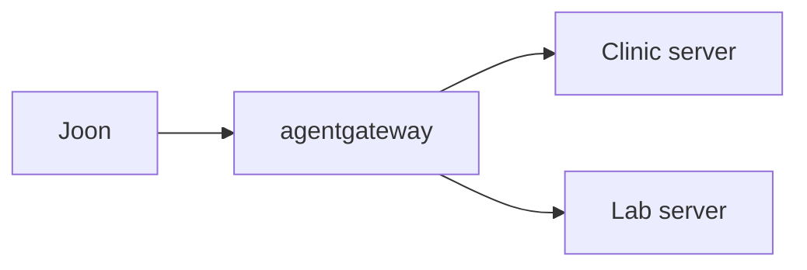

# Put the servers behind agentgateway

## The problem

You wrote a proxy by hand. Many teams use a ready-made gateway instead: a program in front of your servers that checks who calls and which tools they may use. For example, agentgateway needs no code, only one `config.yaml`. The starter checks no token and knows one server.



## Watch it done

Before, the starter config fails five of six rules (this check needs Docker to run the gateway):

```text
  PASS  The gateway image is cr.agentgateway.dev/agentgateway:v1.7.0
  FAIL  tools/list through the gateway shows tools from the clinic server and the lab server
  FAIL  A request with no token is refused with 401
  FAIL  The allowed tool returns real free slots
  FAIL  A tool that is not on the allow-list returns an error
  FAIL  The tools list shows only the allowed tools
1 of 6 rules pass.
```

After, the gateway lists two tools, `clinic_find_free_slots` and `lab_blood_panel_status`. A call with no token gets 401. A call to `lab_export_all_results` is refused. The check prints `Done. All 6 rules pass.` On a machine without Docker the check cannot start the gateway, so it fails even on the solution.

## Your turn

1. Open `assignment/config.yaml`. Add the lab server as a second target, next to the clinic one:

```yaml
- name: lab
  mcp:
    host: http://127.0.0.1:8802/mcp
```

2. Add `jwtAuth` to the route's policies, so a request with no token gets 401:

```yaml
jwtAuth:
  mode: strict
  issuer: https://login.harrowlane.test
  audiences: [http://127.0.0.1:3000/mcp]
  jwks:
    file: /run/keys/public-keys.jwks
```

3. Give each target its own token file with `backendAuth`, for example `/run/keys/clinic.token` and `/run/keys/lab.token`.
4. Add `mcpAuthorization` rules that allow one read-only tool from each server. `mcp.tool.name` has no prefix:

```yaml
- allow: 'mcp.tool.target == "clinic" && mcp.tool.name == "find_free_slots"'
```

5. Make the test keys, start the three containers, and run the check.

```bash
bun assignment/token.ts
docker compose -f assignment/compose.yml up -d
bun run verify put-servers-behind-agentgateway
```

Expect: three containers started (`clinic`, `lab`, `gateway`), then `Done. All 6 rules pass.` Stop them with `docker compose -f assignment/compose.yml down -v`.

## Do it on your work

Write a gateway config for two servers you use. List each tool you would allow and why. Good looks like one allowed read-only tool per server, a token rule, and every new tool refused until you add it.

## Done when

- The gateway image tag is `v1.7.0`.
- The tool list shows tools from both servers.
- A request with no token gets 401.
- The allowed tool returns real free slots.
- A tool off the allow-list returns an error.
- The list shows only the allowed tools.

## Solution

The after state is one `config.yaml` with two targets, a token rule, a key per target and an allow-list. See `solution/config.yaml`.

## Go further

The graded homework is in `assignment/README.md`. Run `bun assignment/check.ts` to write `assignment/result.json`.

## If you get stuck

- The list is empty: `mcp.tool.name` is `find_free_slots`, not `clinic_find_free_slots`.
- Calls fail with a token error: each target needs its own `backendAuth`.

## Words you will use

- **Gateway**: a program in front of your servers that checks callers and passes calls on.
- **Target**: one server behind the gateway. Its name becomes the tool prefix.
- **Allow-list**: the only tools a caller may use.
- **JWT**: a signed token that says who the caller is.
