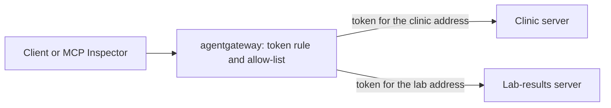

# Route tool calls through agentgateway

## The problem

You built every piece by hand: a proxy, token checks and a tool allow-list. Teams that run MCP servers in
production often use an open-source gateway for this job. It is one small program you configure, not code you
maintain.

This is an optional closing part. It repeats one thing you just built, with the tool teams use. Nothing earlier in the
course changes.

For example, Joon's token reaches the gateway on port 3000. The gateway lists tools from the clinic server and the
lab server, and lets him call only the two read-only ones. The risky `export_all_results` stays out of reach.

## Why it matters

A hand-built proxy is the right way to learn, because you see every decision. It is a poor way to run a clinic. Each
change to it is code to review, test and deploy.

A gateway moves those decisions into one config file. We measured agentgateway version 1.7.0 idle in Docker. It used
about 14 MiB of memory, and 21 MiB after a few calls. The two course servers beside it used about 85 MiB together.

The diagram shows the plan. It is the same plan as the hand-built proxy.



## What we teach

- How to list two servers as targets behind one address.
- How to require a signed token, and send each server a token made for it.
- How to write an allow-list, so a caller sees only the tools you name.
- How to prove it with a check that calls the gateway as a client.

## Steps

| Step                              | Minutes | You produce                                                         | The check reads                                                                            |
| --------------------------------- | ------- | ------------------------------------------------------------------- | ------------------------------------------------------------------------------------------ |
| `put-servers-behind-agentgateway` | 25      | `assignment/config.yaml` with two targets, a token rule, allow-list | the tool list, a call with no token, an allowed call and a blocked call, all via port 3000 |

Total: 25 minutes.

## Walkthrough

Put both servers behind the gateway:

```bash
bun run verify put-servers-behind-agentgateway
```

Expect: `Done. All 6 rules pass.` once your work meets every Done when line. Before that, each FAIL line has a `Try next:`.

Run the same lines as homework and write `assignment/result.json`:

```bash
bun assignment/check.ts
```

Expect: `Done. Every line passes.` and a new `assignment/result.json` with one `pass` or `fail` per line.

```bash
bun run verify part route-tool-calls-through-agentgateway
```

Expect: `Part route-tool-calls-through-agentgateway is done: 1/1 steps pass.` once the step passes.

## Options

You chose agentgateway. The runner-up is IBM ContextForge.

- **Choose ContextForge when**: you want an admin screen and a registry that tracks many servers.
- **Trade-off**: it has more moving parts than one small program. You run, secure and upgrade more of them.

## Assignment

This part is optional in the live session and expected as homework. The task and the rubric are in
[assignment/README.md](../../assignment/README.md).
